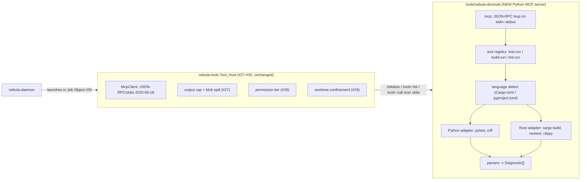
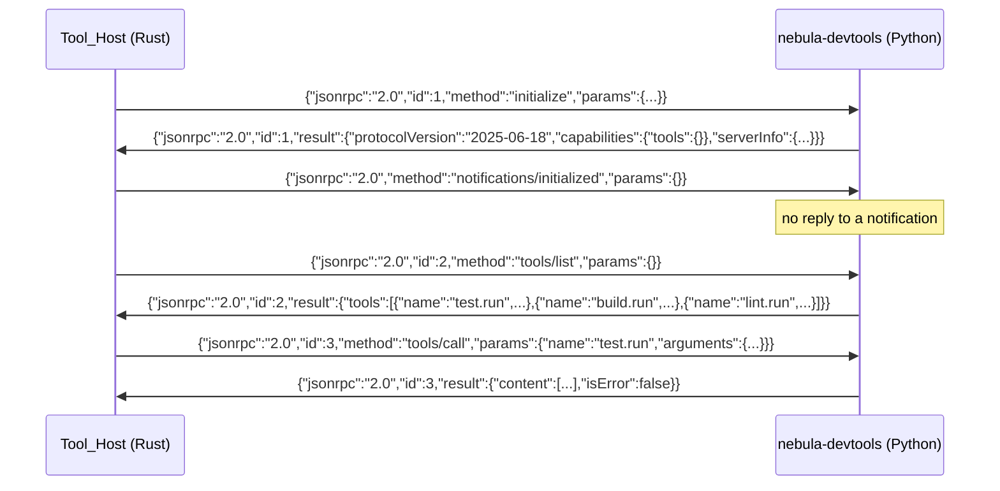
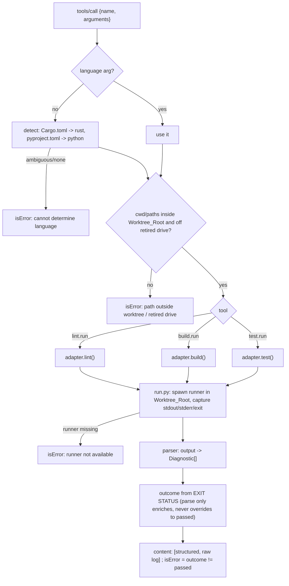

# Design Document

## Overview

This feature ships Nebula's first **external Python MCP tool server** (GitHub issue #33): `nebula-devtools`, a `uv`-managed Python package under `tools/nebula-devtools/` that the daemon launches over stdio and that exposes three build/test/lint tools — **`test.run`**, **`build.run`**, and **`lint.run`** — for Python (uv/pytest/ruff) and Rust (cargo build/nextest/clippy). Each tool runs a runner inside the task's worktree and returns a **short, structured result**: an overall outcome plus per-item diagnostics with `file:line` locations, instead of raw logs.

The daemon's merged tool host (issues #27–#30) already owns every cross-cutting concern — launching the server in a kill-on-close Job Object, the per-call timeout, the output cap with over-cap blob spill, the permission tier, worktree confinement, and the single `tool.call` telemetry event. **This feature implements only the server and its adapters** against the host's existing wire contract; it changes no Rust host code except adding a documented config example and (optionally) a classifier rule so the three tools are tiered as Sandbox.

### Decisions carried in from requirements review

1. **Raw log → host blob spill.** The server returns a short structured result plus the raw log as a separate content block; when the combined output exceeds the server's configured `max_output_bytes`, the host truncates and spills the full output to a blob (issue #27 `cap.rs`). The server writes no log files of its own — no new file lifecycle to manage.
2. **Three tools, not one with a mode.** `test.run`, `build.run`, `lint.run` — each with its own `inputSchema` and its own tier.
3. **v1 runner scope.** Python: `uv run pytest` (test), `uv run ruff check` (lint); Rust: `cargo build` (build), `cargo nextest run` (test), `cargo clippy` (lint). **pyright is deferred** — it needs Node, a runtime this project otherwise avoids; the issue's acceptance (pytest + nextest + compiler/lint `file:line`) is fully met without it.
4. **Tier: Sandbox (Tier 1).** These tools are confined to the worktree, so the #28 classifier assigns them Sandbox and a normal run needs no approval — the executor can run tests autonomously.
5. **Package location:** `tools/nebula-devtools/`, a sibling of `bench/`, its own `uv` package.
6. **Language selection:** an explicit `language` argument wins; otherwise auto-detect from the worktree (`Cargo.toml` → Rust, `pyproject.toml` → Python). Ambiguous/undetectable → `isError`.

## Architecture

### Where it sits



The server is a normal child of the daemon, launched by the host's `StdioLauncher` into the task's Job Object (#30), so every runner subprocess it spawns (`cargo`, `uv`, `pytest`) is a job member and dies with the task. The host enforces the timeout and cap; the server never needs to.

### The Python package layout

```
tools/nebula-devtools/
  pyproject.toml            # uv package: python>=3.12, ruff, pytest; console script `nebula-devtools`
  nebula_devtools/
    __init__.py
    __main__.py             # entry point: run the stdio server loop
    mcp.py                  # JSON-RPC 2.0 over stdin/stdout: initialize, tools/list, tools/call
    server.py               # tool registry; dispatches a call to an adapter; builds the response
    detect.py               # language detection from the worktree
    model.py                # Structured_Result, Diagnostic, Outcome dataclasses + JSON encoding
    run.py                  # subprocess runner: run a command in the worktree, capture stdout/stderr/exit
    adapters/
      __init__.py
      python_adapter.py     # pytest (test), ruff (lint)
      rust_adapter.py       # cargo build (build), cargo nextest (test), cargo clippy (lint)
    parsers/
      __init__.py
      pytest_parser.py      # pytest output -> Diagnostic[]
      nextest_parser.py     # cargo nextest output -> Diagnostic[]
      cargo_parser.py       # cargo/rustc + clippy JSON diagnostics -> Diagnostic[]
      ruff_parser.py        # ruff JSON -> Diagnostic[]
  tests/
    test_mcp.py             # handshake, tools/list, tools/call, bad method, stdout-is-clean
    test_detect.py
    test_parsers.py         # fixture-driven: real captured outputs -> expected Diagnostics
    test_adapters_e2e.py    # real temp repos: one failing pytest, one failing nextest
    fixtures/               # captured runner outputs + tiny sample repos
```

`bench/` is untouched; `nebula-devtools` is a separate package so its dependencies and lint config are independent.

### The MCP protocol loop (`mcp.py`)

The server implements exactly what `crates/nebula-tools/src/client.rs` drives — newline-delimited JSON-RPC 2.0, protocol `2025-06-18`:



Loop rules (Requirement 1):
- Read stdin line by line; parse each as a JSON object. Dispatch by `method`.
- A message with an `id` is a request → always reply with a matching-`id` result or error. A message with no `id` is a notification → never reply.
- **stdout is protocol-only.** All human/diagnostic output (including a runner's own chatter and any server logging) goes to **stderr** (Requirement 1.4). The server sets `logging` to stderr and never `print()`s to stdout.
- Unknown method → JSON-RPC error `-32601`. Unknown tool name in `tools/call` → a result with `isError: true` (not a protocol error), so the host sees a tool-level failure (Requirement 1.5).
- One request is handled at a time (synchronous loop); the host serializes calls per server and enforces the timeout, so the server needs no internal concurrency for v1.

### `tools/call` response shape

The host passes MCP `content` through unchanged and caps it (`ToolCallResult { content, is_error }`). The server returns `content` as an array of MCP text blocks:

- Block 1 — the **Structured_Result** as a compact JSON string (bounded; this is what the model reads).
- Block 2 — the **raw log** as text (stdout+stderr of the run). When block 1 + block 2 exceed the server's `max_output_bytes`, the host truncates and spills the full content to a blob (decision 1, Requirement 5.1–5.2).

```json
{
  "content": [
    { "type": "text", "text": "{\"outcome\":\"failed\",\"tests\":{...},\"diagnostics\":[...],\"truncated\":false}" },
    { "type": "text", "text": "<raw combined stdout/stderr log>" }
  ],
  "isError": true
}
```

`isError` is `true` when the overall outcome is `failed` or `errored`, `false` when `passed` (Requirement 2.2, 8). The structured block is always first and always bounded (Requirement 5.1, 5.3).

### Request flow for a `tools/call`



### Worktree confinement (Requirement 6)

The worktree root is supplied to the server as its **working directory** by the host launcher (the host sets the child's cwd to the task's worktree) and/or passed as the `cwd` argument on each call. The server:
- Runs every runner with `cwd = Worktree_Root` (Requirement 6.1).
- Rejects any `cwd`/path argument that resolves outside the worktree or onto the retired drive (`C:` by default) with `isError`, running nothing (Requirement 6.2). The server receives the retired-drive letter via an env var the host sets (or defaults to `C:`); it compares the resolved absolute path's drive, mirroring the Rust resolver's rule, without needing the full Rust `Path_Resolver`.
- Spawns runners as ordinary children (`subprocess.Popen` without `DETACHED_PROCESS`/`CREATE_NEW_PROCESS_GROUP`), so they inherit the server's Job Object membership and die with the task (Requirement 6.3, 8.4).

### Outcome determination is exit-status-first (Requirement 9)

The overall outcome is derived from the **runner's exit code**, never from the parse:
- exit 0 → `passed` (test/build) or `clean` folded into `passed` (lint with no findings).
- non-zero → `failed` if diagnostics parsed, else `errored` (ran but output unparseable) — never `passed` (Requirement 9.1, 9.2).
- runner could not be spawned (missing tool) → `errored` with `isError` (Requirement 8.1).

Parsed diagnostics only *enrich* a failed/errored outcome with locations; they can never flip it to `passed` (Requirement 9.3). This mirrors the permission-tiers "never downgrade" caution.

## Components and Interfaces

### Data model (`model.py`)

```python
from dataclasses import dataclass, field
from enum import Enum

class Outcome(str, Enum):
    PASSED = "passed"
    FAILED = "failed"
    ERRORED = "errored"

class Severity(str, Enum):
    ERROR = "error"
    WARNING = "warning"
    NOTE = "note"

@dataclass(frozen=True)
class Diagnostic:
    file: str            # relative to Worktree_Root (Requirement 4.3)
    line: int
    message: str
    source: str          # "pytest" | "rustc" | "nextest" | "ruff" | "clippy"
    severity: Severity = Severity.ERROR
    column: int | None = None   # included when the runner reports one (Requirement 4.1)

@dataclass
class StructuredResult:
    outcome: Outcome
    source: str                       # the runner that produced this
    language: str                     # "python" | "rust"
    diagnostics: list[Diagnostic] = field(default_factory=list)
    total_diagnostics: int = 0        # true count before any cap (Requirement 5.3)
    truncated: bool = False           # diagnostics list was capped (Requirement 5.3)
    tests_passed: int | None = None   # populated by test.run
    tests_failed: int | None = None
    note: str | None = None           # e.g. "exit non-zero but no diagnostics parsed"
```

`StructuredResult.to_json()` emits a compact object; `Diagnostic`s are sorted by `(file, line, column)` for stable output (Requirement 4.4). The diagnostics list is capped at a `MAX_DIAGNOSTICS` constant (e.g. 50) with `total_diagnostics`/`truncated` recording the overflow (Requirement 5.3).

### The subprocess runner (`run.py`)

```python
@dataclass
class RunOutput:
    exit_code: int | None   # None if the runner could not be spawned
    stdout: str
    stderr: str
    spawn_error: str | None # set when the runner binary is missing

def run_command(argv: list[str], cwd: str, env: dict[str, str] | None = None) -> RunOutput:
    """Run `argv` with working directory `cwd`, capturing stdout/stderr and the exit code.

    Spawns an ordinary child (no detach / no new process group) so it inherits the server's
    Job Object membership (Requirement 6.3). A missing runner yields RunOutput(exit_code=None,
    spawn_error=...) rather than raising (Requirement 8.1). The host owns the timeout, so this
    does not impose its own.
    """
```

### Adapters (`adapters/`)

Each adapter exposes `build`/`test`/`lint` that return a `StructuredResult` plus the `RunOutput` (for the raw-log block). Not every language has every verb (Python has no separate build); an unsupported verb returns `errored` with a clear note.

```python
class Adapter(Protocol):
    language: str
    def test(self, cwd: str) -> tuple[StructuredResult, RunOutput]: ...
    def build(self, cwd: str) -> tuple[StructuredResult, RunOutput]: ...
    def lint(self, cwd: str) -> tuple[StructuredResult, RunOutput]: ...
```

- **PythonAdapter**: `test` → `uv run pytest -q` (plus a machine-readable mode, see parsers); `lint` → `uv run ruff check --output-format json .`; `build` → not applicable, returns a `passed`/`note` no-op or `errored` with a note (design chooses a no-op `passed` so a mixed-language caller is not blocked — final choice in tasks).
- **RustAdapter**: `build` → `cargo build --message-format json`; `test` → `cargo nextest run` (with its machine-readable output); `lint` → `cargo clippy --message-format json`.

### Parsers (`parsers/`)

Each parser turns a `RunOutput` into `Diagnostic[]`. Chosen formats favour **machine-readable output** over scraping human text, for robustness:
- **cargo/clippy** (`cargo_parser.py`): parse `--message-format json` lines (`compiler-message` with `spans` → file/line/column/severity/message). Covers both `build.run` (rustc) and `lint.run` (clippy).
- **nextest** (`nextest_parser.py`): run with machine-readable output where available; otherwise parse the failure summary lines, and recover the `file:line` from the captured panic/`assert` location. The exit status is authoritative for pass/fail.
- **pytest** (`pytest_parser.py`): invoke pytest so failures carry locations (for example `--tb=short` plus the `path:line` in the failure report, or a small JSON report plugin if already available via uv — tasks pick the lightest reliable option). Each failing test → one `Diagnostic` with its assertion `file:line`.
- **ruff** (`ruff_parser.py`): parse `--output-format json` (array of `{filename, location:{row,column}, code, message}`).

Fixture-driven tests capture real runner outputs and assert the exact `Diagnostic[]`, so parser changes are regression-caught (Requirement 4, test strategy below).

### Config wiring (Rust side, minimal)

A documented example `[tools.servers.devtools]` entry in `config/default.toml` (commented, since tool servers are empty by default and enabled in the local override, per AGENTS.md):

```toml
# [tools.servers.devtools]
# command = "uv"
# args = ["run", "--project", 'F:\...\tools\nebula-devtools', "nebula-devtools"]
# call_timeout_ms = 120000      # builds/tests can be slow; the host kills past this
# max_output_bytes = 1048576    # over-cap output spills to a blob (#27)
# env = [["NEBULA_RETIRED_DRIVE", "C:"]]
```

**On the Sandbox tier (decision 4) and `rules.toml`.** The `nebula-sandbox` classifier matches on *shell command base names* (`classify(command, args)` over `rm`, `git`, `cargo`, …); external MCP tools are dispatched to their server by name and never reach the classifier. So no `rules.toml` row would ever match `test.run`/`build.run`/`lint.run`, and adding one would place dead data in a protected-set file. Per-external-tool tiering is not implemented in the merged #27–#30 host — it belongs to the executor (#32). This design therefore records the **Sandbox-tier** intent (in the README and here) for #32 to honor when it wires external-tool tiers, and changes no `rules.toml`. In the meantime the tools are bounded by the host's worktree confinement, per-call timeout, and the task's kill-on-close Job Object (#30).

## Correctness Properties

Candidate property-based tests (Python, via `hypothesis` if adopted, else table-driven) and invariants:

1. **Exit-status dominates (fail-safe).** For all `(exit_code, parsed_diagnostics)`, `outcome == PASSED` only if `exit_code == 0`. A non-zero exit never yields `PASSED`, even with zero diagnostics. (Requirement 9.1–9.3)
2. **Bounded structured result.** For all runs, the structured block's size is ≤ a fixed bound and the diagnostics list length ≤ `MAX_DIAGNOSTICS`, with `total_diagnostics` ≥ the list length. (Requirement 5.1, 5.3)
3. **Stable diagnostics order.** For all runs, parsing the same `RunOutput` twice yields identical, `(file, line, column)`-sorted `Diagnostic[]`. (Requirement 4.4)
4. **stdout is pure protocol.** For all server interactions, every byte written to stdout parses as a JSON-RPC object; nothing else (runner output, logs) reaches stdout. (Requirement 1.4, 8.3)
5. **Confinement.** For all `cwd`/path arguments outside the worktree or on the retired drive, the tool returns `isError` and spawns no runner. (Requirement 6.2)
6. **Relative file paths.** For all diagnostics whose location is under the worktree, `file` is worktree-relative. (Requirement 4.3)

## Testing Strategy

- **Unit (parsers):** fixture-driven — captured real outputs of `pytest`, `cargo nextest`, `cargo build`, `cargo clippy`, `ruff` → asserted `Diagnostic[]`. These need no toolchain at test time (they read fixtures), so they run anywhere.
- **Unit (mcp loop):** feed JSON-RPC lines on a pipe; assert handshake, `tools/list`, `tools/call`, unknown-method error, unknown-tool `isError`, and that stdout carries only JSON (property 4).
- **End-to-end (gated):** two tiny sample repos under `tests/fixtures/` — one with a single failing `pytest` test, one with a single failing `cargo nextest` test — asserting `test.run` returns overall `failed` with exactly that one failure and its `file:line` (the issue's headline acceptance). These require `uv`/`cargo` present; mark them to skip cleanly when a runner is missing (and still exercise the missing-runner `isError` path, Requirement 8.1).
- **Lint/format gate:** the package passes `uv run ruff check .`, `uv run ruff format --check .`, `uv run pytest -q` (Requirement 1.6), matching the bench harness gate in AGENTS.md.
- **Rust side:** the only Rust change is the documented config example (no `rules.toml` change — see "On the Sandbox tier" above); covered by the `nebula-config` parse tests already in place.

## Security and Safety Considerations

- **Arbitrary code execution is inherent:** `test.run` runs the project's tests, which can execute anything. This is why the tools are **Sandbox-tier and worktree-confined** (decision 4, Requirement 6) and run under the task's kill-on-close Job Object (#30) — a runaway or malicious test is bounded to the worktree and killed with the task.
- **No secrets to stdout/stderr/result** (Requirement 5.4): the server never echoes environment values; the host's redactor still covers the telemetry event.
- **stdout integrity** (Requirement 1.4): corrupting the protocol channel would break the host, so all non-protocol output is rigorously routed to stderr; this is a tested invariant (property 4).
- **Fail-safe parsing** (Requirement 9): a parser bug can only make a run look *worse* (failed/errored), never falsely green, so the executor is never told a broken build passed.
- **No new privileged surface:** the server is plain Python running build tools; it adds no `unsafe`, no Win32, and no network. pyright (and its Node runtime) is deferred, keeping the dependency surface to `uv` + `cargo`, which the project already requires.
