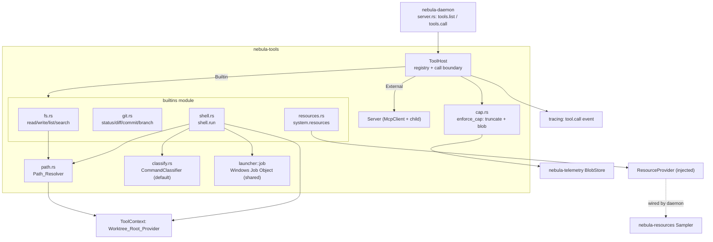
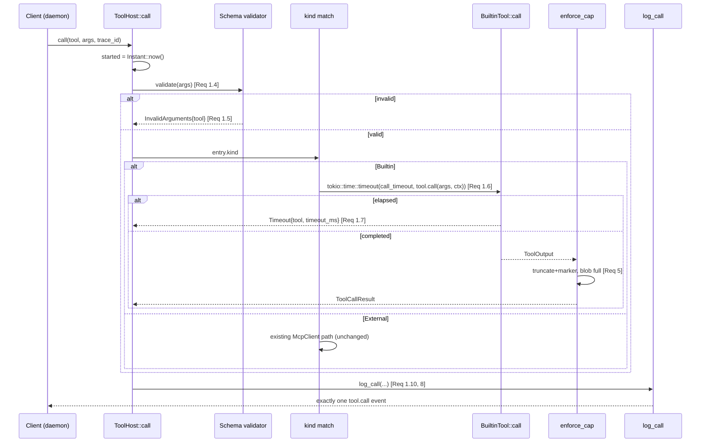

# Design Document

## Overview

This feature adds the **in-process built-in tool** half of the Nebula tool host (GitHub issue #27, design 6.1). PR #42 built the external half: stdio MCP servers launched from `[tools]` and routed through `ToolHost`. This design extends `ToolHost` so Rust in-process tools register alongside external tools, appear in `tools.list`, and are callable via `tools.call` through the **same boundary** — input-schema validation, per-call timeout, output-size cap, and the single `tool.call` telemetry event (Requirement 1, Requirement 8).

The built-ins delivered are:

- `fs.read`, `fs.write`, `fs.list`, `fs.search` — confined to the worktree (Requirement 2).
- `git.status`, `git.diff`, `git.commit`, `git.branch` — confined to the worktree repository, no push (Requirement 3).
- `shell.run` — classified, confined, isolated in a Job Object, refuses above-threshold commands without approval (Requirement 4).
- `system.resources` — wraps the resource snapshot (Requirement 6).

Two cross-cutting pieces are shared by all tools: a single **Path_Resolver** confinement routine (Requirement 7) and a redesigned **output cap** that truncates with a marker and preserves the full output in a blob (Requirement 5).

### Key design decisions

1. **Builtins live inside `nebula-tools`, routed through the existing `ToolHost::call`.** This is the only way to guarantee no built-in bypasses the boundary (Requirement 8.6). A built-in is an `Arc<dyn BuiltinTool>` stored on the registry entry; `call_inner` grows a two-arm match on the entry kind (external server vs. built-in) that converges on the same validation / timeout / cap / logging path.

2. **Injectable boundaries for the not-yet-built crates (#28, #29).** The `Command_Classifier`/approval interface and the `Worktree_Root_Provider` and `ResourceProvider` are defined here as traits and injected via a `ToolContext`. This feature ships a deterministic default classifier sufficient for its acceptance tests. The permission types (`Tier`, `Approval`, `CommandClassifier`) are defined in `nebula-tools` behind a `permit` module so #28 can relocate them into `nebula-sandbox` without churn.

3. **`nebula-tools` does not take a dependency on `nebula-resources`.** `system.resources` returns a `nebula_proto::ResourceSnapshot` obtained through an injected `ResourceProvider` closure/trait, so the crate depends only on `nebula-proto` for the type and the daemon wires the real sampler.

4. **The output cap changes from reject to truncate (Requirement 5).** The current `enforce_cap` returns `OutputTooLarge` when a result exceeds the cap. This design replaces that with truncate-at-UTF-8-boundary + fixed marker + full-output-to-blob, applied uniformly to built-ins and (recommended) external tools. The behavior change for external tools is called out below.

5. **The Windows Job Object module is shared.** `shell.run` reuses the launcher's `job` module rather than duplicating `unsafe` Win32 code; the module is promoted to crate-internal (`pub(crate)`) so both external-server launch and `shell.run` use the one audited surface.

## Architecture

### Component diagram



### How a built-in slots into `ToolHost::call`

The public `call` wrapper is unchanged in signature. Inside `call_inner`, after resolving the registry entry and validating arguments against its schema (shared for both kinds — Requirement 1.4), the entry's `kind` selects the execution path:



The crucial invariant: there is exactly one `log_call` call site (in `call`, wrapping `call_inner`), so every outcome — success, tool error, `InvalidArguments`, `Timeout`, `Unavailable`, `OutputTooLarge` — emits exactly one `tool.call` event (Requirement 1.10, 8.1, 8.4, 8.6).

### Timeout semantics: builtin vs. external

- **External** (unchanged): on timeout the owning server's child is killed; the `McpClient` future is abandoned.
- **Builtin**: `tool.call(..)` is wrapped in `tokio::time::timeout`. On elapse the future is **dropped**, which is cooperative async cancellation — the built-in stops at its next `.await`. For `shell.run`, the built-in owns a child in a Job Object; dropping its future runs the guard that closes the job handle, killing the child and all descendants (Requirement 4.9). Built-ins that do blocking work (git CLI, blocking file I/O) run it on `tokio::task::spawn_blocking` and hold a kill handle (the Job Object for processes) so cancellation terminates the OS work; purely in-memory built-ins simply stop. This difference is documented on `BuiltinTool`.

## Components and Interfaces

All new types carry doc comments; no `unwrap`/`expect`/`panic` in library code; errors are `thiserror`; async traits use `async-trait` and are object-safe.

### Module layout (new files under `crates/nebula-tools/src/`)

- `builtins/mod.rs` — `BuiltinTool` trait, `ToolOutput`, `ToolContext`, `register_all`.
- `builtins/fs.rs`, `builtins/git.rs`, `builtins/shell.rs`, `builtins/resources.rs` — the tools.
- `path.rs` — `Path_Resolver` and its result type.
- `permit.rs` — `Tier`, `Approval`, `CommandClassifier`, default classifier (candidate to move to `nebula-sandbox` in #28).
- `cap.rs` — the redesigned `enforce_cap`.
- `host.rs` — extended registry (`ToolKind`), `register_builtin`, two-arm `call_inner`.

### The built-in tool trait (Requirement 1)

```rust
/// A Rust, in-process tool registered with the Tool Host. Called through the same boundary as
/// external tools (schema validation, timeout, output cap, `tool.call` telemetry).
#[async_trait::async_trait]
pub trait BuiltinTool: Send + Sync {
    /// Stable tool name (1..=128 chars), unique across all built-in and external tools.
    fn name(&self) -> &str;
    /// Optional human-readable description surfaced in `tools.list`.
    fn description(&self) -> Option<&str> { None }
    /// Non-empty JSON Schema for the tool's arguments.
    fn input_schema(&self) -> serde_json::Value;
    /// The permission tier assigned at registration time (Req 2.10/2.11, 3.14/3.15, 6.5).
    fn tier(&self) -> Tier;

    /// Run the tool. Arguments have already passed schema validation. Implementations MUST be
    /// cancellation-safe: if the returned future is dropped (timeout), any OS resource they own
    /// (child process in a Job Object, open handles) must be released by a drop guard.
    async fn call(&self, arguments: serde_json::Value, ctx: &ToolContext)
        -> Result<ToolOutput, ToolError>;
}
```

### Tool output (Requirement 5)

`ToolOutput` carries the raw payload so the boundary can measure and cap it uniformly in bytes, independent of how a tool produced it:

```rust
/// Raw output produced by a built-in tool, before the output cap is applied.
pub struct ToolOutput {
    /// The full output as bytes (UTF-8 text for fs/git/shell; serialized JSON for resources).
    pub bytes: Vec<u8>,
    /// Whether the tool itself reported a (non-transport) error, mapped onto
    /// [`ToolCallResult::is_error`].
    pub is_error: bool,
}

impl ToolOutput {
    /// Text output helper.
    pub fn text(s: impl Into<String>) -> Self { /* bytes = s.into().into_bytes(), is_error:false */ }
    /// JSON output helper (used by `system.resources`).
    pub fn json(v: &serde_json::Value) -> Result<Self, ToolError> { /* serialize */ }
}
```

The boundary turns a capped `ToolOutput` into the existing `ToolCallResult { content, is_error }` by wrapping the (possibly truncated) UTF-8 text in the MCP content shape already used by external tools, so the daemon's `ToolCallOutcome` wire type is unchanged (no `PROTO_VERSION` bump).

### Tool context (injected boundaries)

```rust
/// Everything a built-in needs that it must not reach for directly. Built by the daemon and
/// shared (cheaply cloned `Arc`s) across all built-ins.
#[derive(Clone)]
pub struct ToolContext {
    /// Supplies the confinement root (issue #29 will provide the per-task implementation).
    pub worktree: Arc<dyn WorktreeRootProvider>,
    /// Classifies shell commands into a tier + approval (issue #28 full engine).
    pub classifier: Arc<dyn CommandClassifier>,
    /// Supplies the latest resource snapshot, or `None` if none taken yet.
    pub resources: Arc<dyn ResourceProvider>,
    /// Per-call timeout and output cap limits.
    pub limits: BuiltinLimits,
}

/// Supplies the directory file and shell operations are confined to (Req 7, Worktree_Root).
pub trait WorktreeRootProvider: Send + Sync {
    /// The current confinement root. May change between calls (issue #29 per-task worktrees).
    fn worktree_root(&self) -> std::path::PathBuf;
}

/// Supplies the most recent resource snapshot without `nebula-tools` depending on
/// `nebula-resources` (Req 6). Returns `None` until the sampler has produced one.
pub trait ResourceProvider: Send + Sync {
    fn latest(&self) -> Option<nebula_proto::ResourceSnapshot>;
}

/// Per-call limits, defaulted from config, clamped to the Req 1.6 range (1..=600 s).
#[derive(Clone, Copy, Debug)]
pub struct BuiltinLimits {
    pub call_timeout: std::time::Duration,
    pub output_cap: usize,
}
```

### Registry extension (Requirement 1, host.rs)

The registry entry gains a `kind`; external tools keep their `server`, built-ins hold the `Arc<dyn BuiltinTool>`:

```rust
enum ToolKind {
    /// Tool owned by an external stdio MCP server (the manifest key).
    External { server: String },
    /// In-process built-in tool.
    Builtin(Arc<dyn BuiltinTool>),
}

struct Tool {
    kind: ToolKind,
    descriptor: ToolDescriptor,     // name, description, input_schema; `server` = "builtin" for built-ins
    validator: Arc<jsonschema::Validator>,
}
```

New registration API:

```rust
impl ToolHost {
    /// Register an in-process built-in. Validates the name length (1..=128) and a non-empty
    /// input schema, compiles the validator, and inserts it. Resolvable thereafter by `name()`.
    ///
    /// # Errors
    /// [`ToolError::InvalidArguments`] if the name is empty / > 128 chars / the schema is empty
    /// or not compilable (Req 1.2); [`ToolError::DuplicateTool`] if the name is already held by a
    /// built-in or external tool (Req 1.12).
    pub fn register_builtin(&mut self, tool: Arc<dyn BuiltinTool>) -> Result<(), ToolError>;
}
```

`register_tool` (external) is **tightened**: on a name already held by a built-in or external tool it now returns `ToolError::DuplicateTool` instead of warn-and-skip (Requirement 1.12). This changes the historical "first server wins, later duplicates skipped" behavior; `add_server` surfaces the error per server (still logged and skipped so one bad server does not down the host, but the specific tool is not silently shadowed). A new `ToolError::DuplicateTool { name }` variant is added.

`list_tools` is unchanged in shape and now includes built-ins (descriptors held in the entry), still sorted by name (Requirement 1.3).

### Output cap (Requirement 5, cap.rs)

```rust
/// Fixed marker appended to truncated inline output. Exact bytes are stable and asserted in tests.
pub const TRUNCATION_MARKER: &str =
    "\n…[nebula: output truncated; full output stored in blob]\n";

/// Apply the output cap in bytes. If `bytes.len() <= cap`, return it whole with no blob (Req 5.2).
/// Otherwise store the full bytes in the blob store BEFORE producing inline output (Req 5.3),
/// truncate the prefix at a UTF-8 char boundary so prefix.len() + MARKER.len() stays within the
/// caller's inline budget, append the marker (Req 5.4), and return the blob ref for logging (5.5).
/// If the blob write fails, return `OutputTooLarge` carrying the truncated prefix (Req 5.6).
fn enforce_cap(
    tool: &str,
    output: ToolOutput,
    cap: usize,
    blobs: Option<&BlobStore>,
) -> Result<(ToolCallResult, Option<String>), ToolError>;
```

Notes:
- Truncation is on the raw bytes with the UTF-8 boundary found by walking back from `cap` until `str::from_utf8` of the prefix succeeds (never splits a code point — Requirement 5.4).
- The blob stores the **full untruncated** bytes and is written first; its ref is returned to `call_inner`, which hands it to `log_call` so the `output_blob` field on the `tool.call` event is the full-output blob (Requirement 5.5). `log_call`'s signature grows an optional precomputed `output_blob` so it does not re-`put` the truncated inline content.
- On blob failure the result is `ToolError::OutputTooLarge` whose message/diagnostic carries the truncated prefix; it is an error, not a success, and records no blob ref (Requirement 5.6). The existing `OutputTooLarge` variant is extended with a `prefix: String` field (and `got`/`cap` kept) for diagnostics.
- **External tools:** recommended to route through the same `enforce_cap` so oversized external results are also truncated-and-blobbed rather than rejected. This is a behavior change from PR #42 (external over-cap previously returned `OutputTooLarge`); the design unifies them and calls it out. The daemon error mapping already treats `OutputTooLarge` as a client error, so the only observable change is that in-range-after-truncation external results now succeed with a marker.

### Path resolver (Requirement 7, path.rs)

```rust
/// Why the Path_Resolver rejected a path. Distinct values let callers map and tests assert the
/// basis (Req 7.5/7.6).
#[derive(Clone, Copy, Debug, PartialEq, Eq)]
pub enum RejectReason {
    /// Resolved path is not contained within the Worktree_Root.
    WorktreeEscape,
    /// Resolved path is on the Retired_Drive.
    RetiredDrive,
}

pub enum Resolved {
    /// Permitted: inside the worktree and off the retired drive. Carries the canonical path.
    Permitted(std::path::PathBuf),
    /// Rejected with the governing reason (retired-drive takes precedence — Req 2.9).
    Rejected(RejectReason),
}

/// The single confinement routine (Req 7.1). `candidate` may be relative (joined to the worktree
/// root) or absolute; `retired_drive` is `resources.retired_drive` (default "C:").
pub fn resolve(
    candidate: &std::path::Path,
    worktree_root: &std::path::Path,
    retired_drive: &str,
) -> std::io::Result<Resolved>;
```

Algorithm (Windows):

1. **Canonicalize the worktree root once** up front (`std::fs::canonicalize`), yielding a `\\?\C:\...` extended-length path. The caller may cache this per resolve; the containment comparison strips a leading `\\?\` from both sides so a resolved child and the root compare on equal footing.
2. **Make the candidate absolute.** Relative candidates join onto the worktree root; absolute candidates are taken as-is. `.`/`..` segments are left for canonicalization.
3. **Canonicalize** the candidate. `std::fs::canonicalize` on Windows resolves `.`/`..`, follows symlinks and NTFS junctions, and returns the `\\?\` form. This is the step that defeats `..` escapes and link-based escapes (Requirement 7.2) because it resolves link targets to their real location before any comparison.
4. **Non-existent paths** (canonicalize errors `NotFound`): walk up to the **nearest existing ancestor**, canonicalize that, then rejoin the remaining non-existent, already `..`/`.`-normalized segments (Requirement 7.3). Lexical normalization of the remainder removes any `..` that would otherwise climb above the ancestor. This path is used by `fs.write` for new files (resolve the parent) and by `fs.list`/`fs.search` targets that may not exist.
5. **Retired-drive check first** (precedence — Requirement 2.9): compare the resolved path's drive letter case-insensitively to `retired_drive`'s letter. If equal → `Rejected(RetiredDrive)`, even for reads and even if also outside the worktree (Requirement 7.6).
6. **Containment check**: lexical prefix check of the resolved path against the canonical worktree root using path components (not raw string prefix, to avoid `C:\work` matching `C:\work-other`). Not contained → `Rejected(WorktreeEscape)` (Requirement 7.5).
7. Otherwise `Permitted(resolved)` (Requirement 7.4).

All file tools and `shell.run`'s path checks call `resolve` and map `Rejected(_)` to `ToolError::InvalidArguments` (Requirement 7.7), performing no file/shell operation.

### File tools (Requirement 2, builtins/fs.rs)

Each is a `BuiltinTool`. The path argument is resolved through `path::resolve` before any I/O; `fs.write` resolves the **parent** for a new file (Requirement 2.2).

- `fs.read { path }` → file bytes as text, output-capped (Requirement 2.3, 2.12). Tier 0.
- `fs.list { path }` → directory entries (names + kind), as text/JSON. Tier 0.
- `fs.search { path, query, ... }` → matches within the permitted subtree, output-capped (Requirement 2.5, 2.12). Tier 0.
- `fs.write { path, content }` → create or update (Requirement 2.6). Tier 1 (independent of any specific path's validity — Requirement 2.11).

On any `Rejected`, the tool returns `InvalidArguments` and leaves the filesystem unchanged (Requirement 2.7, 2.8). Writes resolve before opening the file so a rejected path never creates or truncates anything.

### Git tools (Requirement 3, builtins/git.rs)

Git shells out to the `git` CLI with `current_dir(worktree_root)` (design 4: git CLI primary). To share process plumbing and isolation, git invocations run through the same Job-Object-backed child mechanism as `shell.run` (a small internal `run_git(args, ctx)` helper), with output captured and capped.

- `git.status {}` → working-tree status (Requirement 3.6). Tier 0.
- `git.diff {}` → diff, output-capped (Requirement 3.7, 3.16). Tier 0.
- `git.commit { message, staged? }` → commit staged changes (Requirement 3.8). Tier 1.
- `git.branch { action: "list" | "create", name? }` → list or create (Requirement 3.11). Tier 1 for create.

Rules:
- Repository confinement: operate only on the Worktree_Root repo (Requirement 3.2); `current_dir` is the worktree root and git is run with `--` separators where relevant.
- No push surface: the input schemas expose no push/fetch/pull action, and any remote-mutating request (e.g. a `name` or `action` resolving to push) is refused with `InvalidArguments` with no remote contact (Requirement 3.4, 3.5).
- Missing repository → `Unavailable` (Requirement 3.3). Any other git failure → `Unavailable`, no partial modification (Requirement 3.13).
- `git.commit` with missing/empty (whitespace-only) message → `InvalidArguments`, no commit (Requirement 3.9). No staged changes → `Unavailable`, no commit (Requirement 3.10).
- `git.branch create` with an invalid name (validated with `git check-ref-format --branch`) or an existing branch → `InvalidArguments`, no change (Requirement 3.12).

### Shell tool (Requirement 4, builtins/shell.rs)

`shell.run { command, args?, ... }`:

1. Submit the command to `ctx.classifier.classify(command)` to obtain `(Tier, Option<Approval>)` **before starting any child** (Requirement 4.2, 4.11).
2. If `tier <= No_Approval_Threshold (Tier::Sandbox)` → execute (Requirement 4.3).
3. If `tier > threshold` and no `Approval` → **refuse**: return `InvalidArguments` indicating approval is required, having started no process (Requirement 4.4). This is the acceptance-test behavior ("refuses tier-3 without approval").
4. If `tier > threshold` with an `Approval` present → execute (Requirement 4.5).
5. Execution: assign the child to a **Job Object** (kill-on-close — Requirement 4.6) via the shared `launcher::job` module; launch with a **Scrubbed_Environment** (secret-bearing vars removed, PATH set to the controlled value) and `current_dir = worktree_root` (Requirement 4.7); enforce the per-call timeout measured from child start, killing via the job on elapse and returning `Timeout` (Requirement 4.8, 4.9); cap cumulative output (Requirement 4.10, Req 5).
6. A model second opinion is advisory only and can never lower the tier below the classifier's (Requirement 4.12); the effective tier is `max(classifier_tier, advisory_tier)` and never below `classifier_tier`.

### Permission types and classifier (permit.rs — candidate for #28)

```rust
/// Operation privilege level (design 7.1).
#[derive(Clone, Copy, Debug, PartialEq, Eq, PartialOrd, Ord)]
pub enum Tier {
    /// Tier 0 — read-only.
    Read = 0,
    /// Tier 1 — sandbox write inside the worktree. The No_Approval_Threshold.
    Sandbox = 1,
    /// Tier 2 — workspace; requires approval.
    Workspace = 2,
    /// Tier 3 — system; always requires approval.
    System = 3,
}

/// The highest tier that runs without an approval decision (Tier 1).
pub const NO_APPROVAL_THRESHOLD: Tier = Tier::Sandbox;

/// An approval authorizing a command classified above the threshold. Opaque here; issue #28
/// defines the full grant/scope. Presence alone authorizes in this feature.
#[derive(Clone, Debug)]
pub struct Approval { /* grant id, scope — minimal for #27 */ }

/// Classifies a shell command and reports the approval decision. Full engine is issue #28.
pub trait CommandClassifier: Send + Sync {
    /// Return the tier and any approval decision for `command`.
    fn classify(&self, command: &str, args: &[String]) -> (Tier, Option<Approval>);
}
```

**Default classifier** (deterministic rules subset, design 7.2) ships as `DefaultClassifier`:
- Destructive file ops → Tier 3: `rm -rf`, PowerShell `Remove-Item -Recurse`, `del`, `format`, `diskpart`.
- `git push`, `git reset --hard` on protected refs → Tier 3.
- System config → Tier 3: `reg`, `sc`, `schtasks`, `setx`, `netsh`, `Set-ExecutionPolicy`.
- Global installs → Tier 3.
- Unknown command → Tier 2.
- Otherwise read/sandbox commands → Tier 0/1.

The default classifier never returns an `Approval` on its own, so Tier 2/3 commands are refused unless a test or caller injects an approving classifier. This is sufficient for "refuses tier-3 without approval."

### Resources tool (Requirement 6, builtins/resources.rs)

`system.resources {}` calls `ctx.resources.latest()`:
- `Some(snapshot)` → `ToolOutput::json(&snapshot)` (Requirement 6.2); because it serializes the same `nebula_proto::ResourceSnapshot` the daemon's `resources.snapshot` returns, the fields are equal field-for-field (Requirement 6.4).
- `None` → `ToolError::Unavailable { server: "builtin", detail: "no resource snapshot yet" }` (Requirement 6.3). Tier 0 (Requirement 6.5).

### Daemon wiring

- `nebula_tools::builtins::register_all(&mut host, ctx: ToolContext)` registers all built-ins in one call; `main.rs` builds the `ToolContext` and calls it after `ToolHost::start` (which already loads external servers). Since `register_builtin` takes `&mut self`, `main.rs` registers before wrapping the host in `Arc`.
- The daemon implements the three provider traits: `WorktreeRootProvider` from config (default worktree root), `ResourceProvider` over the daemon's `Shared::latest_snapshot()` (same source `resources.snapshot` uses — guaranteeing Requirement 6.4), and `CommandClassifier` = `DefaultClassifier` for now (replaced by `nebula-sandbox` in #28).
- `resources.retired_drive` (existing config, default `"C:"`) is passed to the resolver.
- Proto: `tools.list`/`tools.call` and the `ToolInfo`/`ToolCallOutcome` wire types are unchanged; no `PROTO_VERSION` bump.

### New config keys

Added to **both** `config/default.toml` and `nebula-config` (with `deny_unknown_fields`, doc comments):

```toml
[tools.builtin]
# Confinement root for built-in file/shell tools until issue #29 supplies per-task worktrees.
worktree_root = "."            # resolved relative to the daemon working dir
# Per-call timeout for built-ins (seconds, 1..=600; Req 1.6). Default 30.
call_timeout_secs = 30
# Inline output cap in bytes (Req 1.8 default 65_536).
output_cap_bytes = 65536
```

`all_paths()` adds the builtin `worktree_root` to the retired-drive doctor check.

## Data Models

### Built-in tool catalog

| Tool | Tier | Input schema (summary) | Output | Req |
|------|------|------------------------|--------|-----|
| `fs.read` | 0 | `{ path: string }` | file contents (text), capped | 2.1, 2.3, 2.10, 2.12 |
| `fs.write` | 1 | `{ path: string, content: string }` | write confirmation | 2.1, 2.6, 2.11 |
| `fs.list` | 0 | `{ path: string }` | directory entries | 2.1, 2.4, 2.10 |
| `fs.search` | 0 | `{ path: string, query: string }` | matches, capped | 2.1, 2.5, 2.10, 2.12 |
| `git.status` | 0 | `{}` | working-tree status | 3.1, 3.6, 3.14 |
| `git.diff` | 0 | `{}` | diff, capped | 3.1, 3.7, 3.14, 3.16 |
| `git.commit` | 1 | `{ message: string }` | commit result | 3.1, 3.8, 3.15 |
| `git.branch` | 1 (create) | `{ action: "list"\|"create", name?: string }` | branch list / create result | 3.1, 3.11, 3.15 |
| `shell.run` | from classifier | `{ command: string, args?: [string] }` | child output, capped | 4.1, 4.10 |
| `system.resources` | 0 | `{}` | `ResourceSnapshot` JSON | 6.1, 6.2, 6.5 |

### Core types

- `BuiltinTool` (trait), `ToolOutput`, `ToolContext`, `BuiltinLimits` — above.
- `ToolKind { External { server }, Builtin(Arc<dyn BuiltinTool>) }` on the registry entry.
- `Resolved { Permitted(PathBuf), Rejected(RejectReason) }`, `RejectReason { WorktreeEscape, RetiredDrive }`.
- `Tier`, `Approval`, `CommandClassifier`, `NO_APPROVAL_THRESHOLD`.
- `WorktreeRootProvider`, `ResourceProvider` (traits).
- `TRUNCATION_MARKER: &str`.
- New `ToolError` variants: `DuplicateTool { name }`; `OutputTooLarge` extended with `prefix: String`.

## Correctness Properties

*A property is a characteristic or behavior that should hold true across all valid executions of a system — essentially, a formal statement about what the system should do. Properties serve as the bridge between human-readable specifications and machine-verifiable correctness guarantees.*

### Property 1: No permitted path escapes confinement

*For any* worktree root and *any* candidate path argument, if `path::resolve` returns `Permitted(p)` then `p` is lexically contained (by path components) within the canonicalized worktree root and its drive letter is not the retired drive; and if it returns `Rejected(_)`, the invoking file tool returns `ToolError::InvalidArguments` and performs no filesystem operation (the filesystem is unchanged). This holds across `..` segments, absolute paths, and symlink/junction targets pointing outside the root.

**Validates: Requirements 2.2, 2.7, 7.1, 7.2, 7.3, 7.4, 7.5, 7.7**

### Property 2: Retired-drive rejection takes precedence and carries a distinct reason

*For any* candidate path whose resolved form lies on the retired drive, `path::resolve` returns `Rejected(RetiredDrive)` — including when the path is also outside the worktree (precedence) and including when the requested operation is a read and when the path reaches the retired drive through a symlink or junction. The `RetiredDrive` reason is distinct from `WorktreeEscape`, and the drive comparison is case-insensitive.

**Validates: Requirements 2.8, 2.9, 7.6**

### Property 3: Output cap truncates within bounds and preserves the full output

*For any* `ToolOutput` and cap: if its byte length is ≤ cap, `enforce_cap` returns the complete output unchanged with no blob. If its byte length is > cap and the blob store succeeds, the returned inline text is valid UTF-8, its byte length is ≤ cap, it ends with the fixed `TRUNCATION_MARKER`, and the stored blob decodes to exactly the original full output; the blob ref is recorded on the `tool.call` event. If the blob write fails, the result is `ToolError::OutputTooLarge` whose carried prefix is valid UTF-8 within the cap, with no success result and no blob ref.

**Validates: Requirements 1.8, 1.9, 2.12, 3.16, 4.10, 5.1, 5.2, 5.3, 5.4, 5.5, 5.6, 5.7**

### Property 4: An above-threshold command without approval never starts a process

*For any* command the classifier maps to a tier strictly greater than `NO_APPROVAL_THRESHOLD` with no approval present, `shell.run` returns `ToolError::InvalidArguments` and starts zero child processes (verified by a spy launcher that records every spawn).

**Validates: Requirements 4.2, 4.4, 4.11**

### Property 5: Exactly one `tool.call` event per invocation, carrying the trace id

*For any* invocation and *any* outcome (success, tool-level error, `InvalidArguments`, `Timeout`, `Unavailable`, `OutputTooLarge`), `ToolHost::call` emits exactly one `tool.call` telemetry event that carries the trace id passed to it and records an outcome classification and an elapsed duration.

**Validates: Requirements 1.10, 8.1, 8.2, 8.4, 8.6**

### Property 6: A second opinion never lowers the enforced tier

*For any* classifier tier and *any* advisory second-opinion tier, the tier `shell.run` enforces is greater than or equal to the classifier tier (it is `max(classifier, advisory)` and never below the classifier tier).

**Validates: Requirements 4.12**

### Property 7: The scrubbed environment removes secrets and pins PATH and cwd

*For any* parent process environment, the environment `shell.run` passes to a child contains no secret-bearing variable (by the known-names and secret-pattern rules), has `PATH` set to the controlled value, and the child's working directory is the worktree root.

**Validates: Requirements 4.7**

### Property 8: `system.resources` output equals the snapshot field-for-field

*For any* `ResourceSnapshot` the `ResourceProvider` yields, the value returned by `system.resources`, when deserialized, equals that snapshot field for field — the same value the daemon's `resources.snapshot` returns for the same sampler state.

**Validates: Requirements 6.2, 6.4**

### Property 9: Registration validation accepts valid tools and rejects invalid ones

*For any* name of length 1..=128 with a non-empty, compilable input schema, `register_builtin` succeeds and the tool is thereafter resolvable by that exact name and appears in `list_tools`; and *for any* empty name, name longer than 128 characters, or empty/uncompilable schema, `register_builtin` returns an error and the registry is left unchanged.

**Validates: Requirements 1.1, 1.2, 1.3**

### Property 10: Tool names are unique across both maps; unknown names are rejected

*For any* name already held by a registered built-in or external tool, registering that name again (as built-in or external) returns `ToolError::DuplicateTool` identifying the name and leaves the existing registration intact (no replace, no shadow); and *for any* name held by neither map, `tools.call` returns `ToolError::UnknownTool` identifying the name and invokes nothing.

**Validates: Requirements 1.11, 1.12**

## Error Handling

Every built-in failure maps onto an existing (or newly added) `ToolError` variant; the daemon's `tool_err` mapping already classifies these into RPC error codes and all pass through `log_call`.

| Condition | ToolError | Req |
|-----------|-----------|-----|
| Name empty / > 128 / empty schema at registration | `InvalidArguments` | 1.2 |
| Registration name collision (either map) | `DuplicateTool { name }` (new) | 1.12 |
| `tools.call` name in neither map | `UnknownTool(name)` | 1.11 |
| Arguments fail schema validation | `InvalidArguments { tool, detail }` | 1.5, 2.x, 3.9/3.12, 4.4 |
| Built-in exceeds per-call timeout | `Timeout { tool, timeout_ms }` | 1.7, 4.9 |
| Output over cap, blob write fails | `OutputTooLarge { tool, got, cap, prefix }` (extended) | 5.6 |
| Path resolver `Rejected(WorktreeEscape)` | `InvalidArguments` | 2.7, 7.7 |
| Path resolver `Rejected(RetiredDrive)` | `InvalidArguments` | 2.8, 2.9, 7.7 |
| No git repo at worktree root | `Unavailable { server: "builtin", detail }` | 3.3 |
| `git.commit` empty/missing message | `InvalidArguments` | 3.9 |
| `git.commit` no staged changes | `Unavailable` | 3.10 |
| `git.branch` invalid/existing name | `InvalidArguments` | 3.12 |
| Push / remote-mutating git request | `InvalidArguments` (no remote contact) | 3.5 |
| Other git failure | `Unavailable` | 3.13 |
| `shell.run` above threshold, no approval | `InvalidArguments` (approval required) | 4.4 |
| `system.resources` with no snapshot yet | `Unavailable` | 6.3 |

Built-ins never panic; all fallible paths return `Result<_, ToolError>`. Partial-modification avoidance: path checks and validation happen before any mutating I/O (file open, git mutation), so a rejected call leaves state unchanged (Requirements 2.7/2.8, 3.9/3.10/3.12/3.13).

## Testing Strategy

### Unit tests (examples, edge cases, registration)

- **Registration smoke**: `register_all` registers the exact ten tool names with their declared tiers (Requirements 2.1/2.10/2.11, 3.1/3.14/3.15, 4.1, 6.1/6.5).
- **fs path-escape attempts** (the issue #27 acceptance item): `..` traversal, absolute paths outside the worktree, a symlink and an NTFS junction whose target is outside the worktree, and `C:` paths — each asserts `InvalidArguments` and an unchanged filesystem (Requirements 2.7, 2.8). These run on Windows with real temp worktrees and real junctions (`mklink /J` equivalent via the Win32 API) redirected into tempdirs.
- **git examples**: dirty-repo status/diff, commit of staged changes advances HEAD, no-staged-changes → `Unavailable`, missing message → `InvalidArguments`, branch list/create, invalid/existing branch → `InvalidArguments`, non-repo dir → `Unavailable`, push-like request refused (Requirements 3.3, 3.5–3.13).
- **shell timeout/job**: a sleeping command hits the timeout and is killed via the job, returning `Timeout` (Requirements 4.8, 4.9).
- **resources**: provider `Some` returns the snapshot; `None` → `Unavailable` (Requirements 6.2, 6.3).
- **telemetry example**: an event is emitted with outcome and `wall_ms` fields present (Requirement 8.3); redaction of secret-bearing content is covered by the telemetry crate's existing redaction tests, exercised here as an integration check (Requirement 8.5).

### Integration tests (through the daemon)

- `tools.list` returns built-ins alongside externals; `tools.call` on each built-in round-trips through the real `ToolHost` and the `ToolCallOutcome` wire type (Requirements 1.3, 1.4).
- Job Object kill-on-close terminates a child process tree (Requirement 4.6) — reuses the launcher's job tests.
- `system.resources` output equals `resources.snapshot` output for the same sampler state (Requirement 6.4).

### Property-based tests

PBT applies to this feature: path confinement, output-cap truncation, tier/approval refusal, and registration are pure/decidable functions over large input spaces. We use **`proptest`** (the workspace's property-testing library); property tests are **not** hand-rolled. Each property test runs **a minimum of 100 iterations** and is tagged with a comment referencing its design property:

```
// Feature: builtin-tools, Property 1: no permitted path escapes confinement
```

Mapping (each correctness property implemented by a single property-based test):

- **P1 / P2** — `path::resolve` over generated worktree roots and adversarial candidate paths (`..` chains, absolute paths, retired-drive paths, link targets built in tempdirs). The highest-risk security code; generators cover escape and retired-drive classes. Rejections are checked to produce `InvalidArguments` with an unchanged filesystem.
- **P3** — `enforce_cap` over generated byte outputs (including multibyte UTF-8 straddling the cap boundary) and caps, with both a working and an injected failing blob store.
- **P4** — `shell.run` over generated commands with a classifier returning tier > threshold and no approval, asserting a spy launcher records zero spawns.
- **P5** — `ToolHost::call` over generated outcomes (via fake built-ins) capturing emitted `tool.call` events, asserting exactly one carrying the trace id.
- **P6** — effective-tier function over generated classifier/advisory tier pairs.
- **P7** — environment-scrub function over generated parent environments.
- **P8** — serialize/deserialize round-trip of generated `ResourceSnapshot` values through `system.resources`.
- **P9 / P10** — `register_builtin`/`register_tool` over generated names (valid, over-length, empty), schemas, and pre-populated registries.

All tests redirect every path to tempdirs and never touch real user paths, per the workspace convention.
