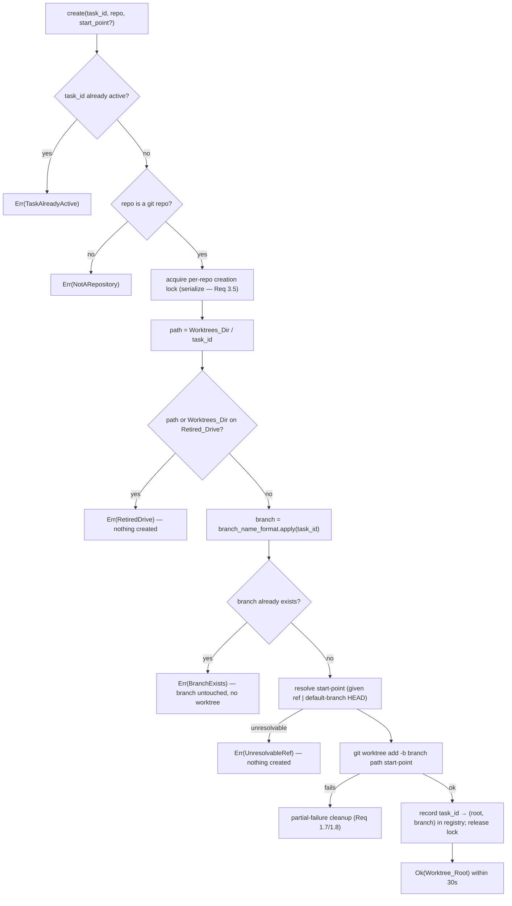
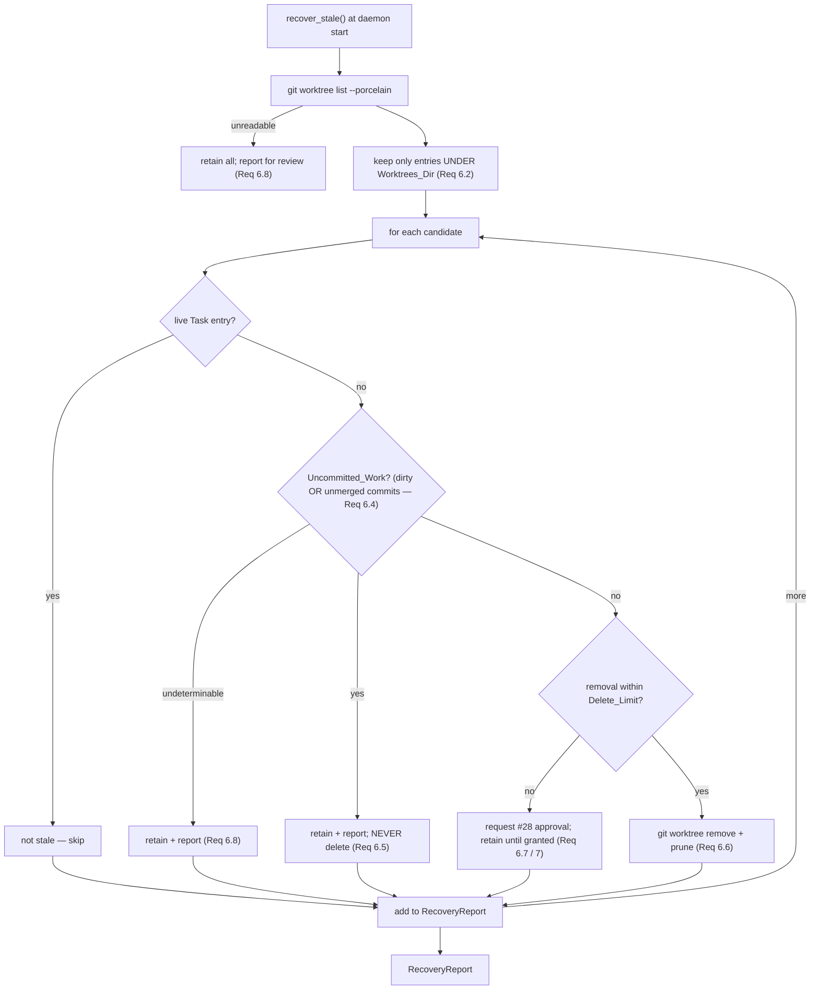
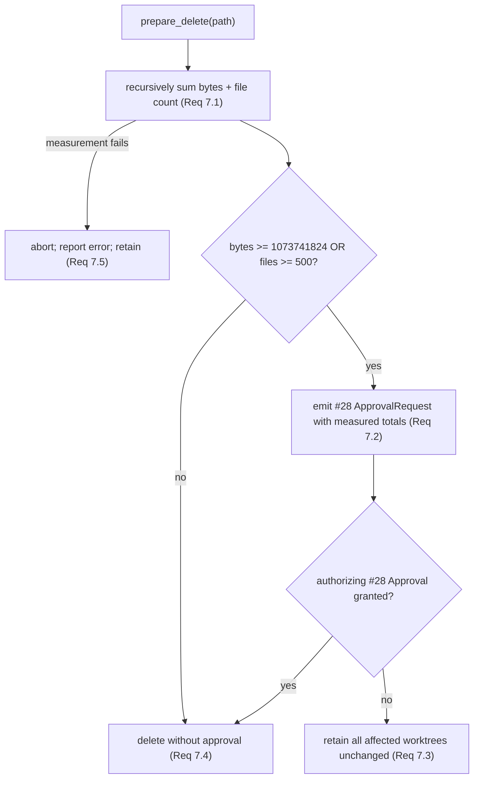

# Design Document

## Overview

This feature gives every Nebula task its own git worktree and branch (GitHub issue #29, design Section 4.4, `core` / protected-set label). It replaces the single static `ConfigWorktreeRoot` that issue #27 wired into `nebula-daemon/src/builtin_providers.rs` with a **per-task confinement root**, and it adds a **`Worktree_Manager`** — the create / finalize / remove / recover lifecycle API the executor loop (issue #32) will call.

The feature fills the seam issue #27 already left open. `nebula-tools` defines a `WorktreeRootProvider` trait (`worktree_root(&self) -> PathBuf`, infallible — see `crates/nebula-tools/src/builtins/mod.rs`); every `fs.*` and `shell.run` path check funnels through the `Path_Resolver` (`crates/nebula-tools/src/path.rs`), which confines paths to `worktree_root()` and rejects anything on the `Retired_Drive`. This feature supplies the **correct per-task root** behind that trait; it does **not** redesign or reimplement path confinement — the resolver's behaviour is owned by #27 and only *referenced* here.

The `Worktree_Manager` lives in the **`nebula-sandbox` crate** created by issue #28 (the home for isolation and safety machinery — the permission engine today, the shared Job Object (#30) later). This feature depends on #28's permission types: the delete-limit approval gate **reuses #28's `Approval` grant contract** rather than inventing a second approval mechanism. When a cleanup deletion would exceed the delete-limit, the `Worktree_Manager` emits an `ApprovalRequest` and refuses to delete until an authorizing `Approval` is granted.

### The three primary risks the design pins down

This is a protected-set, data-sensitive feature. Three risks drive every requirement, and each is pinned by a correctness property:

1. **The owner's `Main_Checkout` must never be modified.** All task working-tree changes happen inside the task's worktree; the main checkout's HEAD, checked-out branch, and `git status --porcelain` output are identical before and after any task operation (Property 1).
2. **No two tasks may collide.** Distinct live tasks get distinct `Worktree_Root`s and distinct `Task_Branch`es, concurrent creation is serialized, and no path confined to one task's root resolves into another's (Property 2).
3. **Cleanup must never silently discard work or over-delete.** A worktree containing `Uncommitted_Work` is never deleted, and no single deletion exceeds the `Delete_Limit` (1 GiB / 500 files) without a recorded #28 approval (Property 5, Property 6).

### Settled decisions (baked into this design)

- **Branch naming:** `nebula/<task-id>` by default, via a configurable format string (`worktree.branch_name_format`, default `"nebula/{task_id}"`). The `nebula/` namespace never collides with the owner's own `feat/*` / `fix/*` branches, and #36's bot PR flow can filter on the prefix.
- **Worktree directory naming:** by `Task_Id` under the configured `Worktrees_Dir` (default `F:\Nebula\worktrees\`). `Task_Id`s are stable and collision-free, so there are no sanitization edge cases.
- **`Uncommitted_Work` detection:** a dirty working tree (`git status --porcelain` non-empty) **OR** commits on the `Task_Branch` that exist nowhere else (unmerged/unpushed). Either condition means "has work", so the worktree is retained, never silently deleted.
- **Abandoned-task worktrees are kept** for inspection. Only PR-opened tasks have their worktree removed automatically; abandoned ones are retained and reported until explicit cleanup.
- **Per-task root selection** keys on the current task carried in a `tokio` task-local the executor sets around a task's tool calls. "No task in scope" resolves to a **rejected-sentinel** path (one the `Path_Resolver` always rejects), keeping the infallible `worktree_root(&self) -> PathBuf` signature intact so no #27 call site in `fs.rs` / `shell.rs` / `git.rs` moves.

### Scope boundaries

- **Confinement is reused, not rebuilt.** This feature returns the correct per-task root; the resolver's escape/retired-drive rejection is #27's.
- **The executor loop is #32.** This feature exposes the API #32 calls at task start / finalize; it does not implement the executor or the `task.create` IPC surface. It *shows* how #32 will set the task-local.
- **Push and PR creation are #36.** This feature creates the branch and worktree and **keeps the branch**; it performs no `git push`, no PR creation, no merge (AGENTS.md hard rule 1).
- **The delete-limit approval mechanism is #28's.** This feature consumes `Approval` / `ApprovalRequest`; it does not define them.

## Architecture

### The `nebula-sandbox::worktree` module

The feature adds a `worktree` module to `nebula-sandbox` (alongside #28's permission engine). It exports the `WorktreeManager` the executor drives, the per-task `WorktreeRootProvider` implementation the daemon installs, and the task-local the two share.

```mermaid
flowchart TD
    executor["executor loop (#32, future)<br/>sets CURRENT_WORKTREE task-local"]
    executor -->|create/finalize/remove| mgr
    executor -->|CURRENT_WORKTREE.scope(Some(root))| tasklocal

    subgraph sandbox["nebula-sandbox"]
        subgraph wt["worktree module (NEW)"]
            mgr["WorktreeManager<br/>create / finalize / remove_worktree / recover_stale"]
            tasklocal["CURRENT_WORKTREE: task_local!(Option&lt;PathBuf&gt;)"]
            provider["TaskWorktreeProvider<br/>impl nebula_tools::WorktreeRootProvider"]
            report["RecoveryReport / StaleWorktree"]
            measure["delete-size measurement + Delete_Limit gate"]
        end
        permit["permit engine (#28)<br/>Approval, ApprovalRequest, ApprovalStore"]
    end

    mgr -->|shell out| git["git CLI<br/>worktree add / list / remove / prune"]
    mgr -->|over-limit delete| permit
    provider -->|reads| tasklocal
    measure --> permit

    subgraph daemon["nebula-daemon"]
        wiring["builtin_providers.rs::build_tool_context"]
    end
    wiring -->|installs| provider
    wiring -->|creates at start| mgr

    subgraph tools["nebula-tools (#27, unchanged)"]
        trait["WorktreeRootProvider trait<br/>worktree_root(&self) -> PathBuf"]
        resolver["path.rs::resolve → Permitted | Rejected(RetiredDrive|WorktreeEscape)"]
    end
    provider -. implements .-> trait
    resolver -->|confines| provider
```

The `WorktreeManager` is the clean integration seam: the executor issues **no** `git worktree` commands directly (Requirement 9.5). Every git invocation is internal to the manager.

### git commands used

The manager shells out to the `git` CLI, consistent with #27's `git.*` tools (design 4: "git CLI primary"). The commands:

| Operation | git command |
|---|---|
| Create worktree + branch | `git worktree add -b <branch> <path> <start-point>` |
| Enumerate registered worktrees | `git worktree list --porcelain` |
| Remove a worktree directory | `git worktree remove <path>` (refuses a dirty tree) |
| Clear removed registrations | `git worktree prune` |
| Resolve default-branch HEAD / a ref | `git rev-parse --verify <ref>` |
| Check branch existence | `git rev-parse --verify --quiet refs/heads/<branch>` |
| Detect unmerged commits | `git rev-list --count <branch> --not --all` |
| Dirty working tree | `git -C <worktree> status --porcelain` |

These run through a small internal `run_git` helper mirroring `git.rs::run_git`: `tokio::process::Command::new("git")` with `current_dir` set to the target repository (for create/list/prune) or the worktree (for status), stdout/stderr piped, bounded by a timeout. The git child processes could later run under #30's shared Job Object, but that is **not required for #29**; the manager uses `kill_on_drop(true)` so a dropped future terminates git in the meantime.

Because git shelling is blocking-ish and the manager is called from async executor code, each operation `.await`s the piped-output future; the manager's public methods are `async`.

### Creation flow (Requirement 1)



- The start-point is the caller's ref when supplied (Requirement 1.2); otherwise the current HEAD of the repository's default branch (Requirement 1.1). An unresolvable supplied ref rejects with a descriptive error and creates nothing.
- The worktree directory is always `Worktrees_Dir / <task_id>` on the configured hot drive (Requirements 1.3, 8.3). `Worktrees_Dir` and every path are resolved from config — no hard-coded drive (Requirement 8.1).
- **Retired-drive rejection (Requirements 1.9, 8.2):** before any git call, the resolved `Worktrees_Dir` and target path are checked against `resources.retired_drive` using the same drive-letter comparison the `Path_Resolver` uses; a match rejects with a descriptive error and nothing is created.
- **Branch collision (Requirement 1.5):** if `refs/heads/<branch>` already exists, the manager rejects without creating the worktree or touching the existing branch.
- **Partial-failure cleanup (Requirements 1.7, 1.8):** if `git worktree add` fails after creating the directory or branch, the manager measures the partial directory; if the measurement is within the `Delete_Limit` it removes the directory and leaves no registration; if it would exceed the limit it aborts removal, retains the directory, and returns an error saying manual cleanup is required.
- **Serialization (Requirement 3.5):** creation for a given repository is serialized behind a per-repo async lock so two simultaneous requests cannot be assigned the same root or branch.

### Per-task confinement root (Requirement 2)

The crux of the seam. A `tokio` task-local holds the executing task's root:

```rust
tokio::task_local! {
    /// The worktree root of the task currently executing, or `None` when no task is in scope.
    /// The executor sets this (via `CURRENT_WORKTREE.scope(Some(root), fut)`) around all of a
    /// task's tool-calling work; built-in tools read it through `TaskWorktreeProvider`.
    pub static CURRENT_WORKTREE: Option<std::path::PathBuf>;
}
```

`TaskWorktreeProvider` implements `nebula_tools::WorktreeRootProvider`. Its `worktree_root()` reads the task-local:

- `Some(root)` → that root (Requirements 2.1, 2.3).
- `None`, or no task-local in scope at all → the **rejected sentinel** (Requirement 2.5).

Because each `tokio` task carries its own copy of the task-local, concurrent tasks each read their own root through the single shared provider instance (Requirement 2.4) — there is no shared mutable "current task" to race on. The read is a task-local lookup and a `clone`, well under the 50 ms bound (Requirement 2.3).

**The rejected sentinel.** The sentinel is a constant path the `Path_Resolver` is guaranteed to reject regardless of candidate. The natural choice reuses the retired-drive rule the resolver already enforces (`path.rs::resolve` returns `Rejected(RetiredDrive)` for anything on the retired-drive letter, and that check runs first):

```rust
/// The confinement root returned when no task is in scope. It is on the retired drive, so
/// `path::resolve` rejects every candidate against it with `RejectReason::RetiredDrive`
/// (path.rs runs the retired-drive check first and unconditionally). No real worktree is ever
/// placed here, so a built-in that resolves against it cannot touch any task's files.
const NO_TASK_SENTINEL: &str = r"C:\nebula\no-task-in-scope";
```

Any `fs.*` / `shell.run` call made with no task in scope therefore resolves against a root the resolver rejects, the built-in fails with a confinement error, no other task's root is ever returned, and every task's worktree state is left unchanged (Requirement 2.5). This keeps the infallible trait signature — no #27 call site changes.

> Why not change the trait to be fallible? That would ripple into every `fs.rs` / `shell.rs` / `git.rs` call site that calls `ctx.worktree.worktree_root()`. The rejected-sentinel approach achieves the same "fail closed" behaviour with zero #27 churn, routing the failure through the resolver that already owns rejection.

### Daemon wiring (Requirement 2.2)

`builtin_providers.rs` today constructs `Arc::new(ConfigWorktreeRoot { root })` inside `build_tool_context`. The change: construct the `WorktreeManager` once at daemon start and install **exactly one** `TaskWorktreeProvider` in place of `ConfigWorktreeRoot`:

```rust
// in nebula-daemon::start, once at startup:
let worktrees = WorktreeManager::new(config.worktree.clone(), config.resources.retired_drive.clone());
let recovery = worktrees.recover_stale().await;      // Requirement 6 / 9.4
tracing::info!(event = "worktree.recovery", stale = recovery.stale.len());

// in build_tool_context, replacing ConfigWorktreeRoot:
ToolContext {
    worktree: Arc::new(TaskWorktreeProvider::new()),   // reads CURRENT_WORKTREE (Req 2.2)
    classifier: /* #28 RulesClassifier */,
    resources,
    retired_drive: config.resources.retired_drive.clone(),
    limits: config.tools.builtin.limits(),
}
```

`ConfigWorktreeRoot` is removed from the wiring path so no built-in call thereafter resolves through it (Requirement 2.2). The `SamplerResourceProvider` / `NoResourceProvider` wiring is untouched.

**How the executor (future #32) sets the task-local.** When #32 runs a task's work, it wraps the tool-calling future in the task-local scope so every built-in call that future makes reads the task's root:

```rust
// Illustrative #32 usage — not built by this feature:
let root = worktrees.create(&task_id, &repo, start_point).await?;   // this feature
CURRENT_WORKTREE
    .scope(Some(root.clone()), async {
        run_executor_turn(&task_id).await   // fs.*/shell.run inside read `root`
    })
    .await;
// On task finalize, #32 calls worktrees.finalize(&task_id) / remove_worktree.
```

The scope is entered per task; nested spawned tasks inherit the value or are given their own scope. Outside any scope (daemon-internal calls, a bug), the task-local is unset and the provider yields the sentinel.

### Completion lifecycle (Requirement 5)

`finalize` and `remove_worktree` are separate operations (Requirement 5.2):

- **`finalize(task_id)`** retains the `Task_Branch` (Requirement 5.1) so #36 can open a PR, and returns the retained branch name. It does **not** delete the branch (Requirement 5.4). Removal of the directory is a distinct call.
- **`remove_worktree(task_id)`** removes the worktree directory, then runs `git worktree prune` (Requirement 5.3). It uses `git worktree remove <path>`, which **refuses to remove a dirty tree** — a safety net that backs the `Uncommitted_Work` protection (Requirement 5.6). Before removing, it measures the directory and applies the `Delete_Limit` gate (Requirement 5.5, via Requirement 7). It removes only that task's directory and leaves the branch intact (Requirement 5.4). If removal or prune fails, the branch and any unremoved registration are left intact and an error is reported (Requirement 5.7).
- **Abandoned tasks** are **not** auto-removed (settled decision). `remove_worktree` is called by #32 only when a task's PR has been opened; abandoned tasks' worktrees are retained and surface in the recovery report until explicit cleanup.

### Crash recovery at daemon start (Requirement 6)



- At a fresh daemon start there is no live Task registry, so every enumerated worktree under `Worktrees_Dir` with no live task entry is a `Stale_Worktree` (Requirement 6.1). (#32 owns the Task registry; the manager consults whatever registry it is given — empty at cold start.)
- **Scope guard (Requirement 6.2):** entries whose path is not under `Worktrees_Dir` are never deleted, pruned, or modified — the owner's own worktrees elsewhere are untouched.
- **`Uncommitted_Work` (Requirement 6.4, settled decision J):** detected as `git status --porcelain` non-empty **OR** `git rev-list --count <branch> --not --all` > 0 (commits on the `Task_Branch` reachable from no other ref).
- Dirty stale worktrees are **retained and reported, never deleted** (Requirement 6.5). Clean ones within the `Delete_Limit` are removed and pruned (Requirement 6.6); over-limit ones go through the #28 approval gate (Requirement 6.7). Any worktree whose registry entry or work-status cannot be determined is retained and reported (Requirement 6.8).
- The report lists each stale worktree's `Worktree_Root`, `Task_Branch`, and `Uncommitted_Work` flag (Requirement 6.3).

### Delete-limit via the #28 `Approval` contract (Requirement 7)

Every removal path (completion `remove_worktree`, recovery, partial-failure cleanup) goes through one gate:



- Measurement sums the exact bytes and file count by recursive traversal **before** any file is removed (Requirement 7.1). The thresholds are exact: `bytes >= 1_073_741_824` or `files >= 500` (Requirement 7.2).
- Over the limit, the manager produces a #28 `ApprovalRequest` (reusing the permission-tiers contract — settled decision B, Requirement 7.6) carrying the measured totals, and **removes nothing** until an authorizing `Approval` is consumed (Requirements 7.2, 7.3). The `Worktree_Manager` does not define its own approval type; it holds a handle to the #28 `ApprovalStore` / approval surface and gates on it, exactly as the permission engine does for an above-threshold command.
- Under both limits, deletion proceeds without approval (Requirement 7.4). A failed measurement aborts and retains (Requirement 7.5).

## Components and Interfaces

All items carry doc comments; no `unwrap`/`expect`/`panic` in library code; errors use `thiserror`; the git child mechanism uses `kill_on_drop(true)` so a dropped future cannot leak a git process.

### `WorktreeManager`

```rust
/// The git-worktree lifecycle API the executor (#32) drives. The executor issues no `git
/// worktree` commands itself (Requirement 9.5); every git invocation is internal here.
///
/// Lives in `nebula-sandbox` beside the #28 permission engine. Holds its configuration, the
/// retired-drive letter it rejects against, per-repository creation locks (Requirement 3.5), the
/// task→(root, branch) registry of live assignments, and a handle to the #28 approval mechanism
/// used to gate over-limit deletions (Requirement 7.6).
pub struct WorktreeManager {
    config: WorktreeConfig,
    retired_drive: String,
    /// task_id → (Worktree_Root, Task_Branch) for currently live tasks.
    live: std::sync::Arc<tokio::sync::Mutex<std::collections::HashMap<TaskId, Assignment>>>,
    /// Per-repository async locks serializing creation (Requirement 3.5).
    repo_locks: std::sync::Arc<tokio::sync::Mutex<std::collections::HashMap<PathBuf, Arc<tokio::sync::Mutex<()>>>>>,
    /// #28 approval surface for the Delete_Limit gate (Requirement 7.6). Reused, not reinvented.
    approvals: std::sync::Arc<nebula_sandbox::ApprovalStore>,
}

/// A live task's worktree assignment.
#[derive(Clone, Debug, PartialEq, Eq)]
pub struct Assignment {
    pub root: PathBuf,
    pub branch: String,
}

impl WorktreeManager {
    /// Build from the `[worktree]` config and the configured `resources.retired_drive`.
    #[must_use]
    pub fn new(config: WorktreeConfig, retired_drive: String, approvals: Arc<ApprovalStore>) -> Self;

    /// Create a worktree and `Task_Branch` for `task_id` against `repo` (Requirement 1, 9.1).
    ///
    /// With `start_point = None` the branch is based on `repo`'s default-branch HEAD
    /// (Requirement 1.1); with `Some(ref)` it is based on that ref, rejecting an unresolvable ref
    /// (Requirement 1.2). The worktree is placed at `Worktrees_Dir/<task_id>` on the hot drive
    /// (Requirements 1.3, 8.3), the branch is named by the configured format and checked out
    /// (Requirement 1.4). Returns the absolute `Worktree_Root` within 30 s (Requirement 1.6).
    ///
    /// # Errors
    /// [`WorktreeError::TaskAlreadyActive`] (Requirement 9.2), [`WorktreeError::NotARepository`]
    /// (Requirement 9.2), [`WorktreeError::UnresolvableRef`] (Requirement 1.2),
    /// [`WorktreeError::BranchExists`] (Requirement 1.5), [`WorktreeError::RetiredDrive`]
    /// (Requirements 1.9, 8.2), [`WorktreeError::CreateFailed`] after partial-failure cleanup
    /// (Requirement 1.7), [`WorktreeError::ManualCleanupRequired`] when cleanup would exceed the
    /// `Delete_Limit` (Requirement 1.8). On any error no live assignment remains and a subsequent
    /// create for the same `task_id` is accepted (Requirement 9.6).
    pub async fn create(
        &self, task_id: &TaskId, repo: &Path, start_point: Option<&str>,
    ) -> Result<PathBuf, WorktreeError>;

    /// Finalize `task_id`: retain the `Task_Branch` for #36 and return it (Requirements 5.1, 9.3).
    /// Does not remove the worktree directory — that is `remove_worktree` (Requirement 5.2).
    ///
    /// # Errors
    /// [`WorktreeError::UnknownTask`] if `task_id` has no live assignment.
    pub async fn finalize(&self, task_id: &TaskId) -> Result<String, WorktreeError>;

    /// Remove `task_id`'s worktree directory (after its PR is opened), then `git worktree prune`
    /// (Requirements 5.2, 5.3). Keeps the branch (Requirement 5.4). Applies the `Uncommitted_Work`
    /// safety net (git refuses a dirty tree — Requirement 5.6) and the `Delete_Limit` gate
    /// (Requirement 5.5 via Requirement 7).
    ///
    /// # Errors
    /// [`WorktreeError::DirtyWorktree`] if the tree is not clean, [`WorktreeError::DeleteLimit`]
    /// when an over-limit removal awaits approval (Requirement 7.3), [`WorktreeError::CleanupFailed`]
    /// leaving branch + registration intact (Requirement 5.7).
    pub async fn remove_worktree(&self, task_id: &TaskId) -> Result<(), WorktreeError>;

    /// Detect `Stale_Worktree`s at daemon start and return a report (Requirements 6, 9.4). Removes
    /// clean, within-limit stale worktrees and prunes them (Requirement 6.6); retains dirty or
    /// indeterminate ones (Requirements 6.5, 6.8); never touches worktrees outside `Worktrees_Dir`
    /// (Requirement 6.2); gates over-limit removals on #28 approval (Requirement 6.7).
    pub async fn recover_stale(&self) -> RecoveryReport;
}
```

### The per-task provider

```rust
tokio::task_local! {
    /// The executing task's worktree root, or `None` when no task is in scope. Set by the executor
    /// (#32) via `CURRENT_WORKTREE.scope(Some(root), fut)` around a task's tool calls.
    pub static CURRENT_WORKTREE: Option<std::path::PathBuf>;
}

/// Per-task implementation of `nebula_tools::WorktreeRootProvider`. One shared instance serves all
/// concurrent tasks: each reads its own `CURRENT_WORKTREE` copy (Requirement 2.4). Installed by the
/// daemon in place of `ConfigWorktreeRoot` (Requirement 2.2).
#[derive(Clone, Copy, Debug, Default)]
pub struct TaskWorktreeProvider;

impl TaskWorktreeProvider {
    #[must_use]
    pub fn new() -> Self { Self }
}

impl nebula_tools::WorktreeRootProvider for TaskWorktreeProvider {
    /// `Some(root)` → that root (Requirements 2.1, 2.3); `None` or no scope → `NO_TASK_SENTINEL`,
    /// which `path::resolve` rejects, failing the originating built-in closed (Requirement 2.5).
    fn worktree_root(&self) -> std::path::PathBuf {
        CURRENT_WORKTREE
            .try_with(|current| current.clone())
            .ok()
            .flatten()
            .unwrap_or_else(|| std::path::PathBuf::from(NO_TASK_SENTINEL))
    }
}
```

### The recovery report

```rust
/// The result of a `recover_stale` pass (Requirement 6.3, 9.4).
#[derive(Clone, Debug, Default)]
pub struct RecoveryReport {
    /// Stale worktrees detected under `Worktrees_Dir`, each with its disposition.
    pub stale: Vec<StaleWorktree>,
}

/// One detected `Stale_Worktree` (Requirement 6.3).
#[derive(Clone, Debug)]
pub struct StaleWorktree {
    pub root: PathBuf,
    pub branch: String,
    /// `true` when dirty or carrying unmerged commits (Requirement 6.4).
    pub has_uncommitted_work: bool,
    /// What recovery did with it.
    pub disposition: Disposition,
}

/// What `recover_stale` did with a stale worktree.
#[derive(Clone, Debug, PartialEq, Eq)]
pub enum Disposition {
    /// Clean and within the limit: removed and pruned (Requirement 6.6).
    Removed,
    /// Dirty / indeterminate: kept for owner review (Requirements 6.5, 6.8).
    RetainedForReview,
    /// Over the `Delete_Limit`: awaiting #28 approval (Requirement 6.7).
    AwaitingApproval { bytes: u64, files: u64 },
}
```

### The error type (`thiserror`)

```rust
/// The single Tool-level error the manager returns (Requirement 9.5): the executor matches on this
/// one enum and never sees a raw git error.
#[derive(Debug, thiserror::Error)]
pub enum WorktreeError {
    #[error("task {0:?} already has an active worktree")]
    TaskAlreadyActive(TaskId),
    #[error("unknown task {0:?}")]
    UnknownTask(TaskId),
    #[error("{0:?} is not a git repository")]
    NotARepository(PathBuf),
    #[error("start-point ref {0:?} could not be resolved")]
    UnresolvableRef(String),
    #[error("branch {0:?} is already in use")]
    BranchExists(String),
    #[error("path {0:?} resolves to the retired drive")]
    RetiredDrive(PathBuf),
    #[error("worktree creation failed: {0}")]
    CreateFailed(String),
    #[error("worktree {0:?} has uncommitted work and was not removed")]
    DirtyWorktree(PathBuf),
    #[error("deletion of {bytes} bytes / {files} files exceeds the delete limit and awaits approval")]
    DeleteLimit { bytes: u64, files: u64 },
    #[error("cleanup of {path:?} would exceed the delete limit; manual cleanup required")]
    ManualCleanupRequired { path: PathBuf },
    #[error("cleanup did not complete: {0}")]
    CleanupFailed(String),
    #[error("git invocation failed: {0}")]
    Git(String),
}
```

### Config additions

```rust
/// The `[worktree]` section. New in issue #29.
#[derive(Clone, Debug, PartialEq, Eq, serde::Deserialize)]
#[serde(deny_unknown_fields)]
pub struct WorktreeConfig {
    /// Parent directory for all per-task worktrees, on the hot drive (Requirement 8.1, 8.3).
    /// Default `F:\Nebula\worktrees`.
    pub worktrees_dir: PathBuf,
    /// Branch-name format; `{task_id}` is substituted with the Task_Id. Default `nebula/{task_id}`
    /// (settled decision H) — the `nebula/` namespace never collides with the owner's own
    /// `feat/*`/`fix/*` branches.
    pub branch_name_format: String,
}
```

Added to `NebulaConfig` as `pub worktree: WorktreeConfig` (with `#[serde(default)]`), and to `config/default.toml` (see Data Models). `WorktreeConfig::validate` rejects a `branch_name_format` missing the `{task_id}` placeholder and a `worktrees_dir` on the retired drive.

## Data Models

### Config keys (`config/default.toml` and `nebula-config`)

Added to **both** the embedded `config/default.toml` and the typed `nebula-config` struct (code convention: a new key goes in both), typed with `deny_unknown_fields` and doc comments:

```toml
# Per-task git worktrees (issue #29). Each task runs in its own worktree + branch so concurrent
# tasks are isolated and the owner's main checkout is never modified.
[worktree]
# Parent directory for all per-task worktrees. Must be on the hot drive and never on the retired
# drive. Each task's worktree is created at <worktrees_dir>\<task-id>.
worktrees_dir = "F:\\Nebula\\worktrees"
# Branch-name format for a task's branch. `{task_id}` is replaced with the task id. The `nebula/`
# prefix keeps task branches clear of the owner's own feat/*/fix/* branches and lets the PR flow
# (issue #36) filter on it.
branch_name_format = "nebula/{task_id}"
```

The `Worktrees_Dir` default is on `F:` (hot) per the AGENTS.md path convention; the `Retired_Drive` continues to come from the existing `resources.retired_drive` (default `"C:"`) — no new key for it.

### The task-local

`CURRENT_WORKTREE: task_local!(Option<PathBuf>)` — `Some(root)` while a task's tool-calling future runs, `None`/unset otherwise. It is the single source of "which task is current"; concurrency correctness follows from `tokio` giving each task its own copy rather than from any lock.

### `git worktree list --porcelain` parsing

Recovery parses the porcelain stanza format (blank-line-separated records, each with a `worktree <path>` line and a `branch refs/heads/<name>` line). Only records whose `worktree` path is a descendant of `Worktrees_Dir` are considered (Requirement 6.2); others are ignored entirely.

## Correctness Properties

*A property is a characteristic or behavior that should hold true across all valid executions of a system — essentially, a formal statement about what the system should do. Properties serve as the bridge between human-readable specifications and machine-verifiable correctness guarantees.*

### Property 1: The main checkout is never modified

*For any* sequence of `Worktree_Manager` operations (create, finalize, remove, recover) over a repository, the `Main_Checkout`'s HEAD commit, checked-out branch name, and `git status --porcelain` output are identical before and after the sequence.

**Validates: Requirements 4.1, 4.2**

### Property 2: Worktree and branch assignments are unique and non-overlapping across live tasks

*For any* set of distinct, concurrently live tasks (up to the configured maximum), their assigned `Worktree_Root`s are pairwise distinct, their `Task_Branch` names are pairwise distinct, and no path confined to one task's `Worktree_Root` resolves (through the `Path_Resolver`) into another task's `Worktree_Root`; concurrent creation requests for the same repository never produce a shared root or branch.

**Validates: Requirements 2.4, 3.1, 3.2, 3.3, 3.5, 4.4**

### Property 3: Every created worktree is placed under the configured Worktrees_Dir, never on the retired drive

*For any* task id and configuration, a successfully created `Worktree_Root` is a descendant of the configured `Worktrees_Dir`; and *for any* configuration whose `Worktrees_Dir` or resulting path lies on the `Retired_Drive`, creation is rejected with a retired-drive error and no worktree is created.

**Validates: Requirements 1.3, 1.9, 8.1, 8.2, 8.3**

### Property 4: No task in scope yields a root the Path_Resolver rejects

*For any* candidate path, when the per-task provider is consulted with no task in scope (the task-local is `None` or unset), the root it returns causes `path::resolve(candidate, root, retired_drive)` to return `Rejected`, so the originating built-in fails closed and no other task's root is ever returned.

**Validates: Requirements 2.5**

### Property 5: A worktree with uncommitted work is never deleted

*For any* worktree, if its working tree is dirty (`git status --porcelain` non-empty) OR its `Task_Branch` carries commits reachable from no other ref, then no cleanup path (completion removal or crash recovery) deletes it — it is retained and reported.

**Validates: Requirements 5.6, 6.4, 6.5**

### Property 6: No single deletion exceeds the Delete_Limit without a recorded approval

*For any* prepared deletion, the deletion proceeds without approval exactly when its measured total is strictly below both limits (`bytes < 1073741824` and `files < 500`); when it meets or exceeds either limit, nothing is removed until an authorizing #28 `Approval` is consumed, and until then all affected worktrees are retained unchanged.

**Validates: Requirements 1.8, 5.5, 6.7, 7.2, 7.3, 7.4, 7.6**

### Property 7: Delete-size measurement equals the actual tree totals

*For any* worktree directory tree, the measured total byte size and file count computed before deletion equal the true sum of the sizes and the true count of the files contained in that tree.

**Validates: Requirements 7.1**

### Property 8: Finalize and remove retain the Task_Branch

*For any* task, after `finalize` and after `remove_worktree`, the `Task_Branch` still resolves to the same commit it did before, and `remove_worktree` deletes only that task's worktree directory.

**Validates: Requirements 5.1, 5.4**

### Property 9: Crash recovery never touches worktrees outside Worktrees_Dir

*For any* mix of registered worktrees inside and outside the configured `Worktrees_Dir`, a `recover_stale` pass deletes, prunes, or modifies only worktrees located under `Worktrees_Dir` and leaves every worktree outside it unchanged.

**Validates: Requirements 6.1, 6.2**

### Property 10: A failed create leaves no state blocking a retry

*For any* create request that fails after partially modifying on-disk or git state, no live assignment remains for that task id and a subsequent create for the same task id is accepted (not rejected as already active).

**Validates: Requirements 1.7, 9.6**

## Error Handling

The manager's public methods return `Result<_, WorktreeError>` — a single Tool-level error enum (Requirement 9.5), so the executor matches on one type and issues no git directly. No library path uses `unwrap`/`expect`/`panic`; git failures map to `WorktreeError` variants rather than propagating raw.

| Condition | Variant / outcome | Req |
|---|---|---|
| `task_id` already live | `TaskAlreadyActive`; nothing created | 9.2 |
| `repo` is not a git repository | `NotARepository`; nothing created | 9.2 |
| Supplied start-point ref unresolvable | `UnresolvableRef`; nothing created | 1.2 |
| Branch name already exists | `BranchExists`; branch untouched, no worktree | 1.5 |
| Path on the retired drive | `RetiredDrive`; nothing created | 1.9, 8.2 |
| `git worktree add` fails, cleanup within limit | `CreateFailed`; partial dir removed, no registration | 1.7 |
| `git worktree add` fails, cleanup over limit | `ManualCleanupRequired`; dir retained | 1.8 |
| `remove_worktree` on a dirty tree | `DirtyWorktree`; nothing deleted | 5.6 |
| Deletion over the `Delete_Limit`, unapproved | `DeleteLimit`; retained, #28 `ApprovalRequest` emitted | 7.2, 7.3 |
| Measurement cannot complete | abort; `CleanupFailed`/`CreateFailed`; retained | 7.5 |
| Removal / prune fails | `CleanupFailed`; branch + registration intact | 5.7 |
| Registry unreadable / work-status indeterminate | retained, reported `RetainedForReview`; never deleted | 6.8 |
| No task in scope (provider) | `NO_TASK_SENTINEL` → resolver `Rejected`; built-in fails closed | 2.5 |

A failed create guarantees idempotent recovery (Requirement 9.6, Property 10): on any error the live registry holds no assignment for the task id, and any partially created directory is removed (within the limit) or flagged for manual cleanup, so a retry is accepted.

## Security Considerations

This is a protected-set, data-sensitive feature (AGENTS.md hard rule 9). Four guarantees are the point of the design and each is pinned by a property:

- **Main checkout invariant.** All task working-tree changes happen inside the task's worktree, through `git worktree` operations that never alter the main checkout's working tree or checked-out branch (Property 1). An attempt to target the main checkout by absolute path, symlink, or `..` traversal is rejected by the reused `Path_Resolver` (Property 2), so the owner's working copy is safe while the agent works.
- **Isolation.** Distinct live tasks get distinct roots and branches, creation is serialized per repository, and confinement to each task's own root is the `Path_Resolver`'s existing job — no path confined to one task resolves into another's (Property 2). The `nebula/` branch namespace keeps task branches clear of the owner's own branches.
- **Uncommitted-work protection + delete-limit (AGENTS.md hard rule 4).** A worktree with uncommitted or unmerged work is never deleted (Property 5), `git worktree remove` refusing a dirty tree is a second safety net, and no single deletion exceeds 1 GiB or 500 files without a recorded #28 `Approval` (Property 6). The limit is enforced in the cleanup code this feature writes, as the hard rule requires. The delete gate reuses the #28 approval mechanism rather than a separate gate (settled decision B).
- **Retired-drive avoidance (AGENTS.md hard rule 5).** No worktree is created on the `Retired_Drive`: creation rejects any path on it before any git call (Property 3), and the no-task sentinel deliberately resolves there so the resolver rejects it. Paths are resolved from config, never hard-coded (Requirement 8.1).

Crash recovery is bounded to `Worktrees_Dir`: it never deletes, prunes, or modifies any worktree the owner keeps elsewhere (Property 9), and it fails safe — anything it cannot read or evaluate is retained and reported, never deleted (Requirement 6.8).

## Testing Strategy

### Unit tests (examples, edge cases)

Tests build **real temporary git repositories** on tempdirs, exactly as #27's `git.rs` tests do (`git init`, configure a committer identity, seed a commit). No test touches a real user path, and no test reads from or writes to `C:` — the retired drive is set to an unused letter (e.g. `"Q:"`) in happy-path tests and to the tempdir's own drive only in the retired-drive-rejection tests.

- **Happy-path create (Requirement 9.1):** `create` over a seeded temp repo returns an absolute root under `Worktrees_Dir`, with the branch checked out.
- **Specified ref / unresolvable ref (Requirement 1.2):** create off a real tag succeeds; a bogus ref returns `UnresolvableRef` and creates nothing.
- **Branch collision (Requirement 1.5):** pre-create the branch, then `create` → `BranchExists`, pre-existing branch unchanged, no worktree directory.
- **Retired-drive rejection (Requirements 1.9, 8.2):** configure `worktrees_dir` on the tempdir's own drive while treating that drive as retired → `RetiredDrive`, nothing created.
- **Dirty-tree removal safety net (Requirement 5.6):** make the worktree dirty, call `remove_worktree` → `DirtyWorktree`, directory retained.
- **Finalize retains branch (Requirements 5.1, 5.4):** finalize then assert the branch still resolves; `remove_worktree` leaves the branch resolvable.
- **Sentinel rejection (Requirement 2.5):** call `TaskWorktreeProvider::worktree_root()` with no task-local scope, feed the result to `path::resolve` for any candidate, assert `Rejected`.
- **No-task-in-scope seam:** a `fs.*`/`shell.run` built-in called outside a `CURRENT_WORKTREE` scope fails with a confinement error (integration of the sentinel with the resolver).
- **Config (`nebula-config`):** `[worktree]` deserializes with `deny_unknown_fields`; a `branch_name_format` missing `{task_id}` and a `worktrees_dir` on the retired drive fail validation.
- **API shape (Requirement 9.5):** every public method returns `Result<_, WorktreeError>`; no git type is exposed.

### Integration tests

- **Two concurrent tasks (Requirements 2.4, 3.1, 3.2):** run two `CURRENT_WORKTREE.scope(Some(root_i), …)` tasks concurrently against one repo; assert each reads its own root and never the other's, and that the two worktrees and branches are distinct.
- **Main-checkout-untouched (Requirement 4.1):** snapshot the main checkout's HEAD, branch, and porcelain; run a create → commit-in-worktree → finalize → remove sequence; assert the snapshot is unchanged.
- **Crash recovery with a dirty worktree (Requirements 6.1, 6.4, 6.5):** register a stale worktree with an uncommitted change and another clean one; run `recover_stale`; assert the dirty one is `RetainedForReview` and the clean one `Removed`, and that the report lists root/branch/flag for each.
- **Recovery scope (Requirement 6.2):** register a worktree outside `Worktrees_Dir`; assert recovery never lists or touches it.
- **Delete-limit via #28 approval (Requirements 7.2, 7.6):** force an over-limit measurement; assert a #28 `ApprovalRequest` is emitted, nothing is deleted, and consuming an authorizing `Approval` lets the deletion proceed.

### Property-based tests

PBT applies: uniqueness, the main-checkout invariant, path confinement, the delete-limit gate, size measurement, and the uncommitted-work predicate are decidable functions over large input spaces. Tests use **`proptest`** (the workspace property-testing library) — not hand-rolled — each running **a minimum of 100 iterations**, each tagged with a comment referencing its design property:

```
// Feature: git-worktree-per-task, Property 2: worktree and branch assignments are unique across live tasks
```

Mapping (one property-based test per correctness property):

- **P1 (main checkout untouched)** — generate random sequences of create/finalize/remove over a seeded temp repo; snapshot and assert HEAD + branch + porcelain unchanged.
- **P2 (uniqueness / isolation)** — generate sets of distinct task ids, create concurrently; assert pairwise-distinct roots and branches, and that `path::resolve` of a path under root A against root B is `Rejected(WorktreeEscape)`.
- **P3 (placement / retired drive)** — generate task ids and configs; assert every created root is under `Worktrees_Dir`, and any config on the retired drive is rejected creating nothing.
- **P4 (sentinel rejected)** — generate candidate paths; with no task scope, assert `path::resolve(candidate, provider_root, retired)` is `Rejected`.
- **P5 (uncommitted work never deleted)** — generate clean / dirty / extra-commit worktrees; assert cleanup retains any with work.
- **P6 (delete-limit gate)** — generate `(bytes, files)`; assert delete-without-approval iff strictly under both limits, otherwise retained pending a recorded approval.
- **P7 (measurement)** — build trees of known byte-size and file-count; assert the measurement equals the true totals.
- **P8 (branch retained)** — generate tasks; assert the branch resolves to the same commit after finalize and after remove, and only the target directory is removed.
- **P9 (recovery scope)** — generate worktrees inside and outside `Worktrees_Dir`; assert recovery touches only those inside.
- **P10 (create recoverable)** — inject create failures; assert no live assignment remains and a retry for the same task id is accepted.

All tests redirect every path to tempdirs and a non-default config, never touch real user paths, and never read from or write to `C:`, per the workspace conventions. Validation runs under `cargo nextest run --workspace --locked`; git-dependent tests follow the `git.rs` pattern of invoking the real `git` CLI against temp repos.
