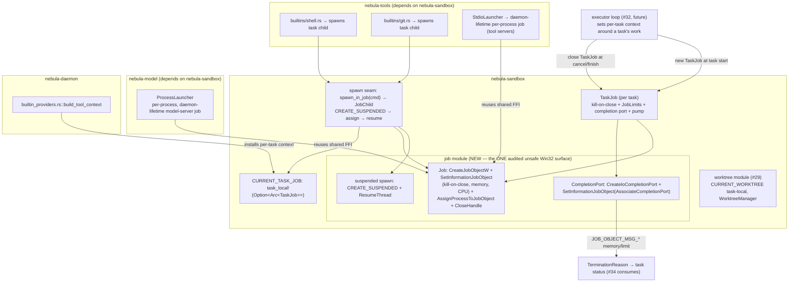

# Design Document

## Overview

This feature gives every Nebula task a single Windows **Job Object** — the **Task_Job** — so that every process the task starts (`shell.run`'s child and all of its descendants, `git.*` children, and build processes) lives inside one kill-on-close job. Closing that one job (on task cancellation or daemon death) terminates the whole process tree with no survivors. It implements GitHub issue #30, satisfies Phase 1 exit criterion 3 ("killing the daemon leaves no task processes behind"), and carries the `core` / protected-set label (AGENTS.md hard rule 9).

Today job-object supervision exists in **two** places, each with its own `KILL_ON_JOB_CLOSE` limit and its own copy of the Win32 FFI:

1. `crates/nebula-model/src/launcher.rs` — a private `job` module that wraps **each llama-server** process in its own job (daemon-lifetime, per model server).
2. `crates/nebula-tools/src/launcher.rs` — a `pub(crate) mod job` plus a `pub(crate) mod child` (issue #27). `spawn_in_job(cmd) -> JobChild` puts **one** child in a fresh per-process job; `shell.run` and the `git.*` built-ins use it, and `StdioLauncher` assigns each external tool server to its own job.

Each child getting its **own** job does not group a task's processes, and a job holding only the direct child does not terminate grandchildren (a shell that launches a build that launches a compiler). This feature replaces the **per-process** scope with a **per-task** scope and consolidates the duplicated unsafe FFI.

### What this feature consolidates

The one audited unsafe Win32 job surface **moves into the `nebula-sandbox` crate** (created by #28, already home to #29's `Worktree_Manager`). After this feature there is exactly **one** `unsafe` `job` module in the workspace (`nebula-sandbox::job`), and:

- `nebula-model` keeps its **daemon-lifetime, per-process** model-server job semantics (a model server is not a task), but builds that job through the **shared** `nebula_sandbox::job::Job` FFI instead of its own duplicate copy.
- `nebula-tools` (`shell.run`, `git.*`) and the executor spawn task children into the **per-task `TaskJob`** built on the same shared surface.

### Tool servers are daemon-scoped, not per-task (settled)

External MCP tool **servers** are launched **once** by #27's host and shared across tasks for their whole daemon lifetime. They are **not** placed in any Task_Job: a tool server must outlive the single task that first used it. They remain supervised by their existing **daemon-lifetime per-process job** (the `StdioLauncher` job from #27, now built on the shared FFI). This is an intentional refinement of Requirement 2.1/2.2's "assign the tool server to the Task_Job" wording, driven by the resolved decision: *only task-spawned child processes* — `shell.run`'s child and its descendants, `git.*` children, and build processes — go in the per-task Task_Job. The "shell that starts a grandchild, cancel, no survivors" acceptance test is about exactly these task-spawned trees.

### The three risks the design pins down

This is a protected-set, safety-critical feature. Three risks drive every requirement, and each is pinned by a correctness property:

1. **No survivors.** After a Task_Job is closed (cancel, normal completion, or daemon death), no process started on behalf of that task — at any depth — remains alive (Property 1, Property 4, Property 5).
2. **Isolation.** Closing one task's job never terminates another task's processes, the daemon, the llama-server processes, or the owner's own processes (Property 3, Property 7).
3. **No handle leak defeats kill-on-close.** The daemon holds exactly one, non-inheritable, long-lived handle per Task_Job; a child never inherits a duplicate that would keep the job alive after the daemon dies (Property 6).

### Scope boundaries and cross-issue dependencies

- **The executor loop is #32.** It owns the task lifecycle and decides *when* a Task_Job is created and closed; this feature provides the Task_Job and the spawn seam #32 and the built-ins call. It *shows* how #32 sets the per-task context but does not build the executor.
- **The worktree is #29.** The `Worktree_Root` and the `Task_Job` are both per-task resources the executor manages; #29 owns the worktree, this feature owns the job. The two share a coherent per-task context (below).
- **Task-status reporting / circuit breakers are #34.** This feature *produces* a `TerminationReason` the executor can read when a limit is breached; #34 consumes it. The 2-second cancellation bound is chosen to match #34's global stop.
- **The approval contract is #28's.** No approval mechanism is defined here.

## Architecture

### Where the pieces live



The executor is the only creator and closer of a `TaskJob`; the built-ins only *spawn into* the current task's job through the seam. Every `git worktree`-style Win32 call is internal to `nebula-sandbox::job`.

### The consolidated `nebula-sandbox::job` module (Requirement 9)

This is the single audited `unsafe` Win32 surface in the whole workspace (AGENTS.md: unsafe denied outside isolated modules; every `unsafe` block carries a `// SAFETY:` comment). It owns exactly these FFI calls and no other module in the workspace declares them (Requirement 9.1, 9.5):

- `CreateJobObjectW` — create a job.
- `SetInformationJobObject` — set `JOBOBJECT_EXTENDED_LIMIT_INFORMATION` (kill-on-close + optional per-process / whole-job memory cap), `JOBOBJECT_CPU_RATE_CONTROL_INFORMATION` (optional CPU cap), and `JOBOBJECT_ASSOCIATE_COMPLETION_PORT` (notification routing).
- `AssignProcessToJobObject` — place a process in the job.
- `CloseHandle` — close the job (and port) handle; the last close triggers kill-on-close.
- `CreateIoCompletionPort` / `GetQueuedCompletionStatus` — the notification pump.
- `ResumeThread` (and the suspended-spawn plumbing) — release an assigned child.

The crate's `Cargo.toml` adds the `windows` features already used by `nebula-tools` (`Win32_Foundation`, `Win32_Security`, `Win32_System_JobObjects`, `Win32_System_Threading`) plus `Win32_System_IO` (completion ports) and `Win32_System_Diagnostics_ToolHelp` (main-thread lookup, below). The module is `#[cfg(windows)]` and `#[allow(unsafe_code)]`; everywhere else `unsafe` stays denied, so an `unsafe` Win32 job call introduced outside this module fails `cargo clippy --workspace --all-targets --locked -- -D warnings` with a diagnostic naming the location (Requirement 9.3). After consolidation, zero duplicate per-process job modules for task scope remain in `nebula-model/src/launcher.rs` or `nebula-tools/src/launcher.rs` (Requirement 9.4): both reference `nebula_sandbox::job::Job`.

### `TaskJob` — one job per task (Requirements 1, 5, 6, 7, 8)

`TaskJob` is the per-task handle the executor owns. Construction (Requirement 1.1):

1. `CreateJobObjectW(None, null)` — an unnamed, owned job (Requirement 6.1: one long-lived handle).
2. Build `JOBOBJECT_EXTENDED_LIMIT_INFORMATION` with `JOB_OBJECT_LIMIT_KILL_ON_JOB_CLOSE`, **plus** `JOB_OBJECT_LIMIT_PROCESS_MEMORY` and/or `JOB_OBJECT_LIMIT_JOB_MEMORY` when a `MemoryLimit` is configured; `SetInformationJobObject` applies it **before any process can be assigned** (Requirement 6.4, 7.1).
3. When a `CpuRateLimit` is configured, a second `SetInformationJobObject` with `JOBOBJECT_CPU_RATE_CONTROL_INFORMATION` (Requirement 8.1).
4. Create an IO completion port and associate it with the job (`JOBOBJECT_ASSOCIATE_COMPLETION_PORT`), then spawn a background pump task (Requirement 7.5, decision O).
5. **Breakaway is never permitted** (Requirement 3.4): the design deliberately **does not** set `JOB_OBJECT_LIMIT_BREAKAWAY_OK` or `JOB_OBJECT_LIMIT_SILENT_BREAKAWAY_OK`. Job membership is therefore inherited by every descendant automatically, and a descendant that passes `CREATE_BREAKAWAY_FROM_JOB` is denied and stays a member (Requirement 3.1).

If any step fails, `TaskJob::new` returns a descriptive `JobError` and no process is ever spawned on behalf of the task (Requirement 1.4). The handle is retained for the task's whole lifetime (Requirement 1.5, 5-series); the executor keeps the single owning `TaskJob` and never duplicates its handle into a child (Requirement 6.1, 6.5).

### The spawn seam: assign before the child can escape (Requirement 4, decision N)

The grandchild-escape race is closed with **`CREATE_SUSPENDED` → `AssignProcessToJobObject` → `ResumeThread`**: a suspended child cannot run a single instruction — and therefore cannot spawn any descendant — until it has been assigned to the job (Requirement 4.1–4.3). The ordering is structural: `resume` is reached **only** on the `Ok` path of `assign`.

**The tokio caveat and the chosen approach.** `tokio::process::Command` exposes `creation_flags` (used today for `CREATE_NO_WINDOW`) and `raw_handle()` (the **process** handle), but it does **not** expose the child's **main thread** handle, and `ResumeThread` needs a *thread* handle. The design uses the **ToolHelp thread-snapshot** approach, which keeps the whole spawn on the existing `tokio::process` path (so the child is a normal `tokio` `Child` with piped stdio and `kill_on_drop`) and is the most robust of the options considered:

1. Add `CREATE_SUSPENDED` alongside `CREATE_NO_WINDOW` via `cmd.creation_flags(CREATE_NO_WINDOW | CREATE_SUSPENDED)` and `cmd.spawn()`. The child exists but its main thread is suspended.
2. `AssignProcessToJobObject(job, child.raw_handle())` — assign while still suspended (Requirement 2.1, 4.1).
3. Find the child's **main thread**: `CreateToolhelp32Snapshot(TH32CS_SNAPTHREAD, 0)`, then `Thread32First`/`Thread32Next`, selecting the thread whose `th32OwnerProcessID == child.id()`. A freshly `CREATE_SUSPENDED` process has exactly one thread, so there is no ambiguity.
4. `OpenThread(THREAD_SUSPEND_RESUME, false, tid)` → `ResumeThread(thread)` → `CloseHandle(thread)` (Requirement 4.3, 4.4: released within the bound).

> Alternatives weighed: calling `CreateProcessW` directly through the `windows` crate yields the thread handle in `PROCESS_INFORMATION` but means re-implementing stdio piping and `tokio` adoption; `NtResumeProcess` is undocumented. The ToolHelp lookup is documented, needs no re-plumbing, and is isolated inside the one unsafe module. This is explicitly the trickiest unsafe part of the feature and is covered by both the no-escape property and a Windows integration test.

If assignment fails, or the suspended child exits before assignment can be confirmed, or the ordering cannot be guaranteed, the seam **terminates the suspended child (never resuming it)**, returns an error, and leaves no process or descendant running (Requirement 2.6, 2.7, 4.5, 4.6). Because the child never resumed, it has no descendants to leak.

### The per-task context: reconciling #29 and #30

Both the worktree root (#29) and the Task_Job (#30) are per-task resources the executor establishes around a task's tool-calling work. They share one coherent pattern — a `tokio` task-local the executor scopes around the task's work, mirroring #29's `CURRENT_WORKTREE`:

```rust
tokio::task_local! {
    /// The Task_Job of the task currently executing, or `None` when no task is in scope. Set by
    /// the executor (#32) via `CURRENT_TASK_JOB.scope(Some(job), fut)` around a task's tool calls,
    /// alongside #29's `CURRENT_WORKTREE`.
    pub static CURRENT_TASK_JOB: Option<std::sync::Arc<TaskJob>>;
}
```

The executor sets **both** task-locals in the same scope, so every `fs.*` / `shell.run` / `git.*` call a task makes reads its own worktree root (#29) *and* spawns its children into its own Task_Job (#30):

```rust
// Illustrative #32 usage — not built by this feature:
let root = worktrees.create(&task_id, &repo, start_point).await?;   // #29
let job  = Arc::new(TaskJob::new(task_id.clone(), limits)?);        // #30, this feature
CURRENT_WORKTREE
    .scope(Some(root), CURRENT_TASK_JOB.scope(Some(Arc::clone(&job)), async {
        run_executor_turn(&task_id).await    // shell.run/git.* spawn into `job`
    }))
    .await;
// finalize: worktrees.finalize / remove_worktree (#29); drop `job` to close it (#30).
```

`shell.run` and `git.*` keep calling the seam exactly as they call `spawn_in_job` today; the seam reads `CURRENT_TASK_JOB`:

- `Some(job)` → spawn the child into **that** task's job (the normal task path).
- `None` / no scope → there is no task-level supervision available. The seam returns a descriptive `JobError::NoTaskInScope` and spawns **nothing** (Requirement 10.4), fail-closed, consistent with #29's rejected-sentinel philosophy. (A daemon-internal call that legitimately needs an un-task-scoped child — none exist among `shell.run`/`git.*`, which only run inside a task — would use a distinct, explicitly-named daemon-lifetime path, never the task seam.)

Because each `tokio` task carries its own copy of the task-local, concurrent tasks spawn into their own jobs through the single shared seam with no shared mutable "current job" to race on (contributes to isolation, Requirement 11.2).

### Cancellation and normal completion (Requirement 5, decision Q)

The executor cancels a task by **closing the Task_Job**: it drops every duplicate handle (there should be none beyond the owning `Arc<TaskJob>`) and closes the last handle; kill-on-close then terminates the whole tree (Requirement 5.1, 5.3). Dropping the last `Arc<TaskJob>` runs `Drop`, which closes the completion port and the job handle. The contract: **zero surviving member processes 2 seconds after the cancellation request is received** (Requirement 5.2) — a fixed bound measured from the request, matching #34's global stop. Normal completion is the same close path (Requirement 5.3).

If a member is still alive 2 seconds after the last handle closed (expected to be impossible, but checked), the daemon reports an error naming the `Task_Id`, retains the count of survivors, records them in telemetry, and keeps attempting termination — without touching any process outside the job (Requirement 3.3, 5.4). If a duplicate handle cannot be dropped so the job cannot be closed, the daemon reports an error naming the `Task_Id` and leaves the task state unchanged (Requirement 5.5).

### Daemon death leaves nothing behind (Requirement 6)

The daemon holds **exactly one** long-lived handle per Task_Job (the owning `TaskJob`), and that handle is **non-inheritable**. When the daemon is killed (`taskkill /F`), the OS closes all its handles; the Task_Job's last handle closes; kill-on-close terminates every member within the OS bound (Requirement 6.2, 6.3 — ≤ 10 s). This is Phase 1 exit criterion 3.

The one way this fails is a **child inheriting a duplicate** of the job handle, which would keep the job alive after the daemon dies. Two defenses:

1. The job handle is created without inheritance and is never passed in a `STARTUPINFO`/handle list, so a spawned child does not receive it. The count of open job handles after a spawn equals the count before (Requirement 6.5). This mirrors the AGENTS.md note that `nebula-cli/src/win.rs` clears the inherit flag on standard handles before spawning the daemon; here the job handle itself is kept non-inheritable.
2. `AssignProcessToJobObject` places the process **in** the job without granting it a handle **to** the job, so assignment never duplicates an inheritable job handle into the child. If a code path ever would produce an inheritable job handle in a child, the seam fails the spawn, terminates the members already assigned to that job, and surfaces an error (Requirement 6.6).

### Memory-limit reason surfacing via the completion port (Requirement 7, decision O)

Associating an IO completion port with the Task_Job lets the daemon learn **why** a process died — a memory-limit breach, not an ordinary exit. The pump (`GetQueuedCompletionStatus` on a dedicated blocking task) maps job messages to a `TerminationReason`:

| Job message | Meaning | `TerminationReason` |
|---|---|---|
| `JOB_OBJECT_MSG_PROCESS_MEMORY_LIMIT` | a member exceeded the per-process memory cap | `MemoryLimit { scope: PerProcess, limit_bytes }` |
| `JOB_OBJECT_MSG_JOB_MEMORY_LIMIT` | the whole job exceeded the job memory cap | `MemoryLimit { scope: WholeJob, limit_bytes }` |
| `JOB_OBJECT_MSG_ABNORMAL_EXIT_PROCESS` | a member crashed | `ProcessCrashed` |
| `JOB_OBJECT_MSG_ACTIVE_PROCESS_ZERO` | the last member exited | (job idle; no reason surfaced) |

The reason is surfaced to the task within 5 seconds of the termination, stating that the Memory_Limit (not an ordinary exit) caused it and reporting the limit value and the scope applied (Requirement 7.5). `TerminationReason` is produced here; #34 consumes it as a task-status field. Scope selection follows the configured `MemoryLimit`: a per-process limit sets `JOB_OBJECT_LIMIT_PROCESS_MEMORY` (the OS terminates the offending member, Requirement 7.3); a whole-job limit sets `JOB_OBJECT_LIMIT_JOB_MEMORY` (the OS terminates the job, Requirement 7.4). With no `MemoryLimit`, the job carries no memory cap (Requirement 7.6). A configured limit less than 1 byte or greater than installed physical memory rejects the task **before** the job is created, with no job left behind (Requirement 7.2).

### CPU rate limit (Requirement 8)

An optional `CpuRateLimit` sets `JOBOBJECT_CPU_RATE_CONTROL_INFORMATION` (`JOB_OBJECT_CPU_RATE_CONTROL_ENABLE | JOB_OBJECT_CPU_RATE_CONTROL_HARD_CAP`, `CpuRate` in hundredths of a percent) at job creation (Requirement 8.1). With no limit, no CPU control is set (Requirement 8.2). Defaults come from config, never hard-coded (Requirement 8.3).

### `nebula-model` migration (per-process, daemon-lifetime)

`nebula-model`'s `ProcessLauncher` still wraps **each** llama-server in its **own** job — a model server is daemon-lifetime, not per-task — but it builds that job through `nebula_sandbox::job::Job::new_kill_on_close()` and `assign()` instead of its private `job` module, which is deleted. The model launcher does **not** use `TaskJob`, the completion-port pump, or the suspended-spawn seam (a model server needs no assign-before-escape race handling and no per-task limits). This keeps the shared unsafe FFI in one place (Requirement 9.4) while preserving model-server semantics, and guarantees model servers are **never** members of any Task_Job (Requirement 11.4).

## Components and Interfaces

All items carry doc comments; no `unwrap`/`expect`/`panic` in library code; errors use `thiserror`; `TaskJob` is stored as `Arc<TaskJob>` so the shared seam reads it without `&mut`.

### The shared, audited unsafe surface — `nebula_sandbox::job`

```rust
#[cfg(windows)]
#[allow(unsafe_code)]
pub mod job {
    //! The one audited `unsafe` Win32 job-object surface in the workspace. `nebula-model` builds
    //! its per-process model-server job from `Job`; `nebula-tools`/#30 build the per-task `TaskJob`
    //! from it. No other module declares `CreateJobObjectW`, `SetInformationJobObject`,
    //! `AssignProcessToJobObject`, or the job-handle `CloseHandle` (Requirement 9.1, 9.5). Every
    //! `unsafe` block is preceded by a `// SAFETY:` comment (Requirement 9.2).

    use std::io;
    use std::os::windows::io::RawHandle;

    /// A Windows Job Object handle. Created with `KILL_ON_JOB_CLOSE` and never configured for
    /// breakaway (Requirement 3.4), so descendants always inherit membership. Non-inheritable:
    /// a spawned child never receives a handle to it (Requirement 6.5). Dropping (including on a
    /// daemon crash) closes the handle; the last close terminates every member (Requirement 6).
    pub struct Job(/* HANDLE */);

    // SAFETY: a job handle is a kernel handle usable from any thread.
    unsafe impl Send for Job {}
    unsafe impl Sync for Job {}

    /// How a memory cap is scoped onto the job.
    #[derive(Clone, Copy, Debug, PartialEq, Eq)]
    pub enum MemoryScope { PerProcess, WholeJob }

    impl Job {
        /// Create a kill-on-close job with no limits (used by `nebula-model`'s per-process job).
        /// # Errors
        /// The underlying Win32 error if creation or configuration fails.
        pub fn new_kill_on_close() -> io::Result<Self>;

        /// Create a kill-on-close job and apply the given optional memory and CPU limits, all set
        /// before this returns so no member can run before the limits are in force
        /// (Requirement 6.4, 7.1, 8.1).
        /// # Errors
        /// The underlying Win32 error if creation or configuration fails.
        pub fn new_with_limits(
            memory: Option<(u64, MemoryScope)>, cpu_rate_hundredths_percent: Option<u32>,
        ) -> io::Result<Self>;

        /// Assign a process (by raw OS handle) to this job. Must be called while the process is
        /// suspended (Requirement 4.1). Does not duplicate an inheritable job handle into the
        /// process (Requirement 6.5).
        /// # Errors
        /// The underlying Win32 error if the assignment fails.
        pub fn assign(&self, process: RawHandle) -> io::Result<()>;
    }

    // Drop closes the handle exactly once via CloseHandle.

    /// An IO completion port associated with a `Job` to receive `JOB_OBJECT_MSG_*` notifications
    /// (Requirement 7.5, decision O).
    pub struct CompletionPort(/* HANDLE */);

    impl CompletionPort {
        /// Create a port and associate it with `job`.
        /// # Errors
        /// The underlying Win32 error if creation or association fails.
        pub fn associate(job: &Job) -> io::Result<Self>;

        /// Block for the next job notification; returns the raw message code and the member PID.
        /// Called from a dedicated blocking task.
        /// # Errors
        /// The underlying Win32 error, except that a close of the port returns `Ok(None)`.
        pub fn next_message(&self) -> io::Result<Option<(u32, u32)>>;
    }

    /// Spawn `cmd` suspended, returning the child and its resumable main-thread handle. The caller
    /// MUST assign the child to a job and then `resume_main_thread` before the child can run
    /// (Requirement 4). `cmd` must already carry `CREATE_SUSPENDED | CREATE_NO_WINDOW`.
    /// # Errors
    /// The spawn error, or the Win32 error locating the main thread.
    pub fn spawn_suspended(
        cmd: &mut tokio::process::Command,
    ) -> io::Result<(tokio::process::Child, ResumeHandle)>;

    /// Owns the suspended child's main-thread handle; `resume()` releases the child to execute.
    pub struct ResumeHandle(/* HANDLE */);
    impl ResumeHandle {
        /// Resume the suspended main thread (Requirement 4.3).
        /// # Errors
        /// The underlying Win32 error if resume fails.
        pub fn resume(self) -> io::Result<()>;
    }
}
```

### `TaskJob` — the per-task handle (Requirements 1, 5, 7, 8, 10)

```rust
/// One Windows Job Object per task (Requirement 1). Owns the job handle, its optional limits, and
/// the completion-port pump. Dropping it closes the last handle so kill-on-close terminates the
/// whole process tree (Requirement 5, 6). Shared as `Arc<TaskJob>` through the spawn seam.
pub struct TaskJob {
    task_id: TaskId,
    job: job::Job,
    /// `None` when no limits are configured; otherwise owns the pump task handle + reason channel.
    notifications: Option<NotificationPump>,
    limits: JobLimits,
}

impl TaskJob {
    /// Create the Task_Job for `task_id`, applying `limits` before any member can be assigned
    /// (Requirement 1.1, 6.4, 7.1, 8.1). Associates a completion port and starts the pump when a
    /// memory limit is configured (Requirement 7.5).
    ///
    /// # Errors
    /// [`JobError::LimitOutOfRange`] if a memory limit is `< 1` byte or `>` installed physical
    /// memory (Requirement 7.2); [`JobError::Create`] if the OS job cannot be created or configured
    /// (Requirement 1.4). On error no job exists and no process is started on the task's behalf.
    pub fn new(task_id: TaskId, limits: JobLimits) -> Result<Self, JobError>;

    /// The task this job belongs to.
    #[must_use]
    pub fn task_id(&self) -> &TaskId;

    /// Receive the next termination reason (e.g. a memory-limit breach), if any (Requirement 7.5).
    /// Returns `None` when no limits/pump are configured.
    pub async fn next_termination_reason(&self) -> Option<TerminationReason>;
}
```

`TaskJob` has no explicit `close`: closing is `Drop` (closing the last handle), so cancellation is "drop the last `Arc<TaskJob>`" (Requirement 5.1, 5.3, 10.3). The executor holds the sole owning `Arc`; the seam clones `Arc`s only to *read* the job for assignment and drops them immediately, never holding a job-handle duplicate open past a spawn (Requirement 6.5).

### The spawn seam (Requirements 2, 4, 10)

```rust
tokio::task_local! {
    /// The current task's Task_Job, set by the executor around a task's work (see #29's
    /// CURRENT_WORKTREE). `None`/unset means no task is in scope.
    pub static CURRENT_TASK_JOB: Option<std::sync::Arc<TaskJob>>;
}

/// A task child kept inside its task's Task_Job. Mirrors #27's `JobChild`, but the job is the
/// per-task job rather than a fresh per-process one. Holding the guard does not keep the job
/// alive beyond the owning `Arc<TaskJob>`; the child dies when the Task_Job is closed.
pub struct JobChild {
    child: tokio::process::Child,
    _job: std::sync::Arc<TaskJob>, // keeps the task's job referenced for the child's lifetime
}

impl JobChild {
    /// The child's OS process id, if any.
    #[must_use]
    pub fn pid(&self) -> Option<u32>;

    /// Wait for the child, collecting stdout/stderr, giving up after `timeout` (the caller then
    /// drops the guard; the child is terminated when the Task_Job closes). Mirrors #27's
    /// `wait_with_timeout`.
    pub async fn wait_with_timeout(
        &mut self, timeout: std::time::Duration,
    ) -> std::io::Result<Option<std::process::Output>>;
}

/// Spawn `cmd` into the current task's Task_Job: suspended spawn → assign → resume
/// (Requirement 4, decision N). `cmd` is configured by the caller (program, args, env, stdio,
/// `current_dir`); the seam adds `CREATE_SUSPENDED | CREATE_NO_WINDOW` and `kill_on_drop(true)`.
///
/// # Errors
/// [`JobError::NoTaskInScope`] if `CURRENT_TASK_JOB` is `None`/unset — nothing is spawned
/// (Requirement 10.4). [`JobError::Spawn`] if the process cannot start. [`JobError::Assign`] if
/// assignment fails — the suspended child is terminated before it can run, leaving no descendant
/// (Requirement 2.6, 4.5, 4.6). [`JobError::ExitedBeforeAssign`] if the child exits before
/// assignment is confirmed — not reported as a successful spawn (Requirement 2.7).
pub fn spawn_in_task_job(cmd: &mut tokio::process::Command) -> Result<JobChild, JobError>;
```

`shell.run` and `git.*` migrate from `nebula_tools::launcher::child::spawn_in_job` to `nebula_sandbox::spawn_in_task_job`; their call sites otherwise stay as they are (`current_dir`, env scrubbing, timeout handling via `wait_with_timeout`). `StdioLauncher` (tool servers) switches its FFI to `nebula_sandbox::job::Job` but keeps its **own daemon-lifetime per-process job** — a tool server is not spawned through the per-task seam (settled decision M). `nebula-tools`'s `pub(crate) mod job` and the per-process part of `mod child` are removed in favour of the shared surface (Requirement 9.4).

### Limits, termination reason, and config carriers

```rust
/// Optional per-task limits applied to a Task_Job. Both default to off in Phase 1 (settled).
#[derive(Clone, Copy, Debug, Default, PartialEq, Eq)]
pub struct JobLimits {
    pub memory: Option<MemoryLimit>,
    pub cpu: Option<CpuRateLimit>,
}

/// A per-task committed-memory cap and its scope (Requirement 7).
#[derive(Clone, Copy, Debug, PartialEq, Eq)]
pub struct MemoryLimit {
    pub bytes: u64,
    pub scope: job::MemoryScope, // PerProcess (Req 7.3) or WholeJob (Req 7.4)
}

/// A per-task hard CPU cap, as hundredths of a percent of total CPU (Requirement 8).
#[derive(Clone, Copy, Debug, PartialEq, Eq)]
pub struct CpuRateLimit {
    pub hundredths_percent: u32, // e.g. 2500 = 25%
}

/// Why a Task_Job's member (or the job) was terminated by this mechanism. Produced here; #34
/// consumes it as a task-status field.
#[derive(Clone, Copy, Debug, PartialEq, Eq)]
pub enum TerminationReason {
    /// A memory cap was exceeded (Requirement 7.5). Carries the applied limit and scope.
    MemoryLimit { limit_bytes: u64, scope: job::MemoryScope },
    /// A member crashed (abnormal exit).
    ProcessCrashed,
}
```

### The error type (`thiserror`, Requirement 10.5)

```rust
/// The single Tool-level error the Task_Job API returns (Requirement 10.5), per the libraries'
/// `thiserror` convention.
#[derive(Debug, thiserror::Error)]
pub enum JobError {
    #[error("task job creation failed: {0}")]
    Create(String),
    #[error("memory limit {bytes} bytes is out of range (must be 1..={physical} bytes)")]
    LimitOutOfRange { bytes: u64, physical: u64 },
    #[error("no task is in scope; refusing to spawn a process outside a task job")]
    NoTaskInScope,
    #[error("spawning the task child failed: {0}")]
    Spawn(String),
    #[error("assigning the child to task {task_id:?}'s job failed: {detail}")]
    Assign { task_id: TaskId, detail: String },
    #[error("the child exited before its assignment to the task job could be confirmed")]
    ExitedBeforeAssign,
    #[error("an inheritable task-job handle was prevented; spawn refused")]
    InheritableHandlePrevented,
    #[error("task {task_id:?} job could not be closed: {detail}")]
    CloseFailed { task_id: TaskId, detail: String },
    #[error("{survivors} member process(es) of task {task_id:?} survived termination")]
    Survivors { task_id: TaskId, survivors: usize },
}
```

## Data Models

### The `[tasks]` config section (settled decision P)

Memory and CPU limits are **off by default** in Phase 1 (opt-in), consistent with the tight VRAM / commit-charge budget noted in AGENTS.md: a chat profile already commits ~9 GB, so a default per-task cap could starve legitimate builds. A new `[tasks]` section is added to **both** the embedded `config/default.toml` and the typed `nebula-config` (code convention: a new key goes in both), typed with `deny_unknown_fields` and doc comments.

`config/default.toml`:

```toml
# Per-task resource limits for task-spawned process trees (issue #30). Each task's processes run
# in one Windows Job Object; these optional caps are applied to that job. OFF BY DEFAULT in Phase 1
# (the VRAM/commit budget is tight — see AGENTS.md). A task may override the defaults.
[tasks]
# Default per-task committed-memory cap, in MiB. 0 (the default) means no cap. When set, a task's
# job is terminated (or its offending process, per `memory_limit_scope`) if it exceeds this.
memory_limit_mib = 0
# Scope of the memory cap: "process" caps each member process; "job" caps the whole task tree.
memory_limit_scope = "job"
# Default per-task hard CPU cap, as a percent of total CPU (1..=100). 0 (the default) means no cap.
cpu_rate_percent = 0
```

`nebula-config` (added to `NebulaConfig` as `#[serde(default)] pub tasks: TasksConfig`):

```rust
/// The `[tasks]` section: optional per-task Job-Object limits (issue #30). Both caps default to
/// off (0) in Phase 1.
#[derive(Clone, Debug, PartialEq, Eq, Deserialize)]
#[serde(deny_unknown_fields)]
pub struct TasksConfig {
    /// Default per-task committed-memory cap in MiB; `0` means no cap (Requirement 7.6, 7.7).
    #[serde(default)]
    pub memory_limit_mib: u64,
    /// Scope of the memory cap (Requirement 7.3, 7.4).
    #[serde(default)]
    pub memory_limit_scope: MemoryScopeConfig,
    /// Default per-task hard CPU cap as a percent of total CPU, `1..=100`; `0` means no cap
    /// (Requirement 8.2, 8.3).
    #[serde(default)]
    pub cpu_rate_percent: u8,
}

#[derive(Clone, Copy, Debug, Default, PartialEq, Eq, Deserialize)]
#[serde(rename_all = "lowercase")]
pub enum MemoryScopeConfig {
    Process,
    #[default]
    Job,
}

impl Default for TasksConfig {
    fn default() -> Self {
        Self { memory_limit_mib: 0, memory_limit_scope: MemoryScopeConfig::Job, cpu_rate_percent: 0 }
    }
}
```

A **per-task override** (set by #32 when creating a task) is carried as the `JobLimits` the executor passes to `TaskJob::new`; the global `[tasks]` defaults are the fallback when a task supplies none. `NebulaConfig::validate` rejects a `cpu_rate_percent` greater than 100; the physical-memory range check for `memory_limit_mib` happens at `TaskJob::new` time (Requirement 7.2), because it depends on the running machine's installed RAM rather than being a static config invariant.

### The per-task context

Two `tokio` task-locals, both set by the executor in one scope: `CURRENT_WORKTREE: Option<PathBuf>` (#29) and `CURRENT_TASK_JOB: Option<Arc<TaskJob>>` (#30). `CURRENT_TASK_JOB` is the single source of "which job is current"; concurrency correctness follows from `tokio` giving each task its own copy, not from a lock.

### `TerminationReason`

As defined above — produced by the completion-port pump, read by the executor, consumed by #34 as a task-status field.

## Correctness Properties

*A property is a characteristic or behavior that should hold true across all valid executions of a system — essentially, a formal statement about what the system should do. Properties serve as the bridge between human-readable specifications and machine-verifiable correctness guarantees.*

Several properties range over process-tree shapes or over real OS behavior (kill-on-close, inheritance, memory enforcement). These are **Windows-gated integration tests** that spawn real process trees; the quantifier ("for all tree shapes", "for all member/non-member sets") is exercised by generating shapes and inputs and asserting on real spawned processes. The heaviest ones (a real `taskkill /F` of a daemon-like host) are `#[ignore]`d real-machine tests per AGENTS.md. Purely structural or decidable properties (handle bookkeeping, message→reason mapping, range validation, source-structure invariants) are unit/`proptest` tests.

### Property 1: No survivors after a Task_Job closes

*For any* task and *any* process tree of arbitrary depth and breadth it spawns (including a `shell.run` child that launches a grandchild at least two levels deep), after the task's Task_Job is closed, no process started on behalf of that task remains alive within the termination bound.

**Validates: Requirements 3.1, 3.2, 5.1, 5.3, 6.3**

### Property 2: Assignment completeness — every task-spawned process is in exactly its task's job

*For any* set of processes spawned on behalf of a task through the seam, each spawned process is a member of exactly that task's Task_Job and of no other Task_Job, and no such process remains unassigned to any Task_Job. (Tool-server processes are excluded by design: they are governed by the daemon-lifetime per-process job, not a Task_Job.)

**Validates: Requirements 2.1, 2.3, 2.4, 2.5**

### Property 3: Isolation — closing one job never affects another task or the daemon

*For any* pair of distinct live tasks, closing one task's Task_Job terminates only that job's members and leaves every member of the other task's Task_Job, the daemon process, and any process not started on behalf of the closed task alive.

**Validates: Requirements 11.1, 11.2**

### Property 4: Daemon death leaves zero task-process survivors

*For any* set of task process trees running under the daemon, when the daemon process is force-terminated (`taskkill /F`), the operating system terminates every member of every Task_Job via kill-on-close within the bound, leaving zero surviving members.

**Validates: Requirements 6.1, 6.2, 6.3**

### Property 5: Assign-before-escape — a child cannot spawn an unassigned descendant

*For any* child spawned through the seam, the child remains suspended (unable to execute any user-controlled code, and so unable to spawn any descendant) until it has been successfully assigned to its task's Task_Job; consequently any descendant it later spawns is already a member of that job and no descendant ever escapes. If assignment fails or cannot be ordered before execution, the child is terminated without ever resuming and no descendant exists.

**Validates: Requirements 3.4, 4.1, 4.2, 4.3, 4.5, 4.6, 10.2**

### Property 6: The job handle count is unchanged by spawning and no child inherits a job handle

*For any* sequence of child spawns into a Task_Job, the count of open handles to that job after each spawn equals the count before it, no spawned child holds a handle to the job, and the daemon holds exactly one long-lived handle; so closing the daemon's single handle (including on crash) always triggers kill-on-close.

**Validates: Requirements 6.1, 6.4, 6.5, 6.6**

### Property 7: Only task-started processes are ever affected

*For any* process the daemon did not start on behalf of a task — the daemon itself, the llama-server processes supervised by `nebula-model` (which live in their own daemon-lifetime per-process job), and any process the owner started outside Nebula — that process is never assigned to any Task_Job and is never terminated by closing a Task_Job.

**Validates: Requirements 11.3, 11.4**

### Property 8: A memory-limit termination surfaces the correct reason

*For any* configured `MemoryLimit`, when the operating system terminates a member (per-process scope) or the job (whole-job scope) because the limit was exceeded, the completion-port pump surfaces a `TerminationReason::MemoryLimit` carrying the applied limit value and the applied scope within the bound, distinguishing it from an ordinary exit.

**Validates: Requirements 7.3, 7.4, 7.5**

### Property 9: Memory-limit configuration is accepted exactly within range

*For any* configured memory-limit value, `TaskJob::new` creates the job exactly when the value is at least 1 byte and at most the installed physical memory; otherwise it rejects the task with an out-of-range error and leaves no Task_Job created.

**Validates: Requirements 7.2**

### Property 10: The audited unsafe surface is unique and fully commented

*For any* build of the workspace, the four job-object FFI calls (`CreateJobObjectW`, `SetInformationJobObject`, `AssignProcessToJobObject`, job-handle `CloseHandle`) appear only in the single `nebula-sandbox::job` module, that module contains an equal number of `unsafe` blocks and `// SAFETY:` comments, and no per-process task-scope job module remains in `nebula-model` or `nebula-tools`.

**Validates: Requirements 9.1, 9.2, 9.4, 9.5**

## Error Handling

Spawning and job creation are the fallible surfaces; closing a job is infallible from the caller's side (it is `Drop`), with a post-close survivor scan guarding the (expected-impossible) failure. No library path uses `unwrap`/`expect`/`panic`; every fallible path returns `Result<_, JobError>`.

| Condition | Variant / outcome | Req |
|---|---|---|
| `CreateJobObjectW` / `SetInformationJobObject` fails | `JobError::Create`; no job, no process started | 1.4 |
| Memory limit `< 1` byte or `>` physical RAM | `JobError::LimitOutOfRange`; task rejected, no job | 7.2 |
| Seam called with no task in scope | `JobError::NoTaskInScope`; nothing spawned | 10.4 |
| Suspended child cannot be spawned | `JobError::Spawn`; nothing left running | 2.6 |
| `AssignProcessToJobObject` fails | `JobError::Assign`; suspended child terminated before resume, no descendants, error | 2.6, 4.5, 4.6 |
| Child exits before assignment confirmed | `JobError::ExitedBeforeAssign`; spawn not reported successful | 2.7 |
| An inheritable job handle would reach a child | `JobError::InheritableHandlePrevented`; spawn fails, assigned members terminated | 6.6 |
| A duplicate handle cannot be dropped to close the job | `JobError::CloseFailed`; task state unchanged | 5.5 |
| Member alive 2 s after last-handle close | `JobError::Survivors`; recorded in telemetry, count retained, termination retried, nothing outside the job touched | 3.3, 5.4 |

A memory-limit termination is **not** an error — it is a normal, surfaced `TerminationReason` the task reports (Requirement 7.5), consumed by #34.

## Security Considerations

This is a protected-set, safety-critical feature (AGENTS.md hard rule 9). Four guarantees are the point of the design, each pinned by a property:

- **No survivors.** Closing a Task_Job terminates the entire task process tree at any depth, because membership is inherited (breakaway is never permitted) and kill-on-close fires on the last handle close — including when the daemon crashes (Property 1, Property 4, Property 5). The assign-before-escape ordering (suspended spawn → assign → resume) closes the one race by which a grandchild could escape before its parent joined the job.
- **Isolation.** Each task's processes live in that task's own job; closing one job never reaches another task's processes, the daemon, or the owner's processes (Property 3, Property 7). Only processes the daemon started on behalf of a task are ever assigned to a Task_Job (Requirement 11.3), satisfying AGENTS.md hard rule 7 ("only stop processes you started").
- **No handle leak defeats kill-on-close.** The daemon holds exactly one non-inheritable handle per Task_Job; spawning a child never duplicates an inheritable handle into it, so a child can never keep the job alive past daemon death (Property 6). This mirrors the AGENTS.md handle-inheritance note for `nebula-cli/src/win.rs`.
- **llama-server and the owner are never touched.** Model servers live in their own daemon-lifetime per-process job and are never members of a Task_Job; the owner's processes are never assigned (Property 7, Requirement 11.4). This mechanism can only terminate task-spawned trees.

The entire Win32 surface is confined to the one audited `nebula-sandbox::job` module, where each `unsafe` block carries a `// SAFETY:` comment and the workspace `-D warnings` clippy run plus the unsafe-outside-allowed-modules lint reject any job FFI introduced elsewhere (Property 10, Requirement 9.3). No path in this feature reads from or writes to the retired `C:` drive, and no secret is logged (the pump logs only PIDs, message codes, limits, and the `Task_Id`).

## What moves, and the migration

**Moves into `nebula-sandbox` (the single audited unsafe surface):**

- The `job` module: `Job` (create/assign/close, kill-on-close, optional memory + CPU limits, no breakaway), `CompletionPort`, `spawn_suspended` + `ResumeHandle`.
- `TaskJob`, `JobChild`, `spawn_in_task_job`, the `CURRENT_TASK_JOB` task-local, `JobLimits`/`MemoryLimit`/`CpuRateLimit`, `TerminationReason`, and `JobError`.

**Changes in `nebula-model`:**

- Delete the private `job` module in `src/launcher.rs`; build the per-process, daemon-lifetime model-server job from `nebula_sandbox::job::Job::new_kill_on_close()` + `assign()`. Behavior unchanged (each model server in its own job); only the FFI home moves. Model servers are never members of a Task_Job.

**Changes in `nebula-tools`:**

- Delete `pub(crate) mod job` and the per-process spawn in `mod child`; `StdioLauncher` builds its daemon-lifetime per-process tool-server job from `nebula_sandbox::job::Job`.
- `shell.run` and `git.*` switch from `child::spawn_in_job` to `nebula_sandbox::spawn_in_task_job`, which reads `CURRENT_TASK_JOB`. When a task is in scope they spawn into the Task_Job; with no task in scope they fail closed (`NoTaskInScope`). Their call sites otherwise stay as they are.

**Dependency edges added:** `nebula-model → nebula-sandbox` and (already present via #28) `nebula-tools → nebula-sandbox`. `nebula-sandbox`'s `Cargo.toml` gains the `windows` features `Win32_Foundation`, `Win32_Security`, `Win32_System_JobObjects`, `Win32_System_Threading`, `Win32_System_IO`, and `Win32_System_Diagnostics_ToolHelp` under `[target.'cfg(windows)'.dependencies]`.

## Testing Strategy

### Unit tests (examples, edge cases, structure)

- **Limits at creation (Requirements 1.1, 7.1, 7.6, 8.1, 8.2):** `TaskJob::new` with and without each limit; assert the extended-limit info carries kill-on-close always, the memory flag only when configured, and the CPU-rate info only when configured.
- **Range validation (Requirement 7.2):** `memory` of `0`, `1`, `physical`, and `physical + 1`; assert accept/reject and that a reject leaves no job (also a `proptest`, Property 9).
- **Message → reason mapping (Requirement 7.5):** map each relevant `JOB_OBJECT_MSG_*` code to the right `TerminationReason` with the configured limit/scope (pure function; also a `proptest`, Property 8's mapping half).
- **Config (`nebula-config`):** `[tasks]` deserializes with `deny_unknown_fields`; defaults are off (`memory_limit_mib = 0`, `cpu_rate_percent = 0`); `cpu_rate_percent > 100` fails validation.
- **No-task-in-scope (Requirement 10.4):** `spawn_in_task_job` with `CURRENT_TASK_JOB` unset returns `NoTaskInScope` and spawns nothing.
- **API shape (Requirement 10.5):** every fallible entry point returns `Result<_, JobError>`; no raw Win32 type is exposed.
- **Assign-failure edge (Requirements 2.6, 4.5, 4.6):** inject an assign failure after a suspended spawn; assert the child is terminated before resume and no process survives.
- **Source-structure scan (Requirements 9.1, 9.2, 9.4, 9.5 — Property 10):** a test scans the crate sources and asserts the four job FFI symbols appear only in `nebula-sandbox::job`, that module's `unsafe {` count equals its `// SAFETY:` count, and no `job` module remains in `nebula-model`/`nebula-tools` launchers.

### Property-based tests (`proptest`, min. 100 iterations)

`proptest` is the workspace library; property tests are not hand-rolled. Each is tagged, e.g.:

```
// Feature: job-objects-for-tasks, Property 9: memory-limit configuration is accepted exactly within range
```

- **Property 9 (range validation)** — generate memory values around the boundaries; assert accept iff `1..=physical`, reject otherwise with no job.
- **Property 8 (reason mapping)** — generate `(message code, limit, scope)`; assert the mapping yields the correct `TerminationReason`.
- **Property 6 (handle bookkeeping)** — generate spawn sequences against a fake/real job; assert the open-handle count is invariant across spawns and the daemon holds exactly one handle.

### Windows-gated integration tests (`#[cfg(windows)]`)

These spawn real process trees against a real Job Object. Tree shapes are generated to exercise the "for all shapes" quantifier of the no-survivors and isolation properties.

- **Property 1 / 5 — no survivors, assign-before-escape (Requirements 3.1, 3.2, 4, 5.1, 5.2):** spawn a `shell.run`-style child that launches a grandchild at least two levels deep; cancel (close the Task_Job); assert **zero survivors within 2 seconds of the cancellation request** (decision Q), and that the grandchild was a member before the kill (never escaped). Use `IsProcessInJob` to confirm membership (Requirement 2, 3.1).
- **Property 3 — isolation (Requirements 11.1, 11.2):** run two task trees plus a sibling non-member process; close one job; assert only that job's members die and the other task's members and the sibling survive.
- **Property 8 — memory limit (Requirements 7.3, 7.4, 7.5):** a member runs a runaway allocator under a configured `MemoryLimit`; assert the OS terminates it (per-process) or the job (whole-job) and that `next_termination_reason` yields `TerminationReason::MemoryLimit` with the right limit and scope within 5 seconds.
- **Breakaway denied (Requirement 3.4):** a child attempts `CREATE_BREAKAWAY_FROM_JOB`; assert it remains a member and is killed on close.

### Real-machine test (`#[ignore]`d per AGENTS.md)

- **Property 4 — daemon death (Requirements 6.2, 6.3; Phase 1 exit criterion 3):** launch a daemon-like host that creates a Task_Job and a task process tree, `taskkill /F` the host, and assert zero surviving members within 10 seconds. This needs a real separate process and is `#[ignore]`d, run locally with `cargo nextest run --run-ignored all`.

All tests follow the workspace conventions: no test touches a real user path or the retired `C:` drive, integration-test files open with `#![allow(clippy::unwrap_used, clippy::panic, missing_docs)]`, and validation runs under `cargo nextest run --workspace --locked` (with the Windows-gated and `#[ignore]`d tests run locally on the real machine).
