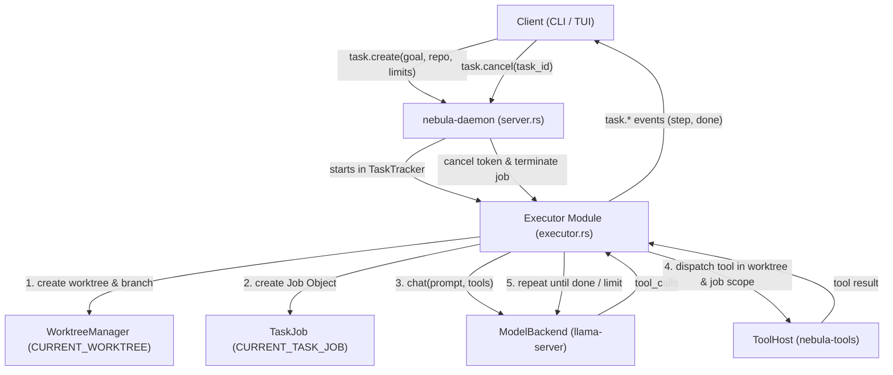
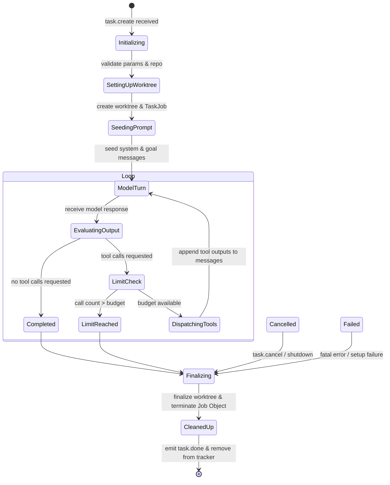

# Design Document: Single Executor Loop with Bounded Tool Calls

## Overview

This feature delivers Nebula's **first agent loop** (GitHub issue #32, design Section 5): a single executor that autonomously runs a task to completion using the local model and available MCP tools inside an isolated git worktree and Windows Job Object. It establishes the headline **Phase 1 exit criterion**: Nebula fixing a failing test in a small repository, end-to-end, without human intervention during execution.

The single executor loop integrates the foundational capabilities shipped in issues #27–#31 and #33:
- **Model Backend** (`nebula-model`): `ModelBackend::chat` with native schema-constrained tool calling.
- **Tool Host** (`nebula-tools`): `ToolHost::list_tools` and `ToolHost::call` with timeout, output capping, and blob spilling.
- **Git Worktree Isolation** (`nebula-sandbox::worktree` / issue #29): per-task worktree via `WorktreeManager` and the `CURRENT_WORKTREE` task-local.
- **Process Supervision** (`nebula-sandbox::task_job` / issue #30): per-task Windows Job Object via `TaskJob` and the `CURRENT_TASK_JOB` task-local.
- **Permission Tiers** (`nebula-sandbox` / issue #28): Tier-checked execution inside `shell.run`, `git.*`, etc.
- **Structured Telemetry** (`nebula-telemetry`): trace, task, and step IDs threaded across model turns and tool executions.

## Architecture

### System Topology



### Component Placement

1. **`crates/nebula-daemon/src/executor.rs`**:
   The core execution loop is implemented as an internal module of `nebula-daemon`. This gives direct access to daemon state (`Arc<Shared>`)—including `ModelManager`, `Arc<ToolHost>`, and `Arc<WorktreeManager>`—without introducing circular crate dependencies or premature abstractions before Phase 2 (planner/verifier).
2. **`crates/nebula-proto`**:
   - New wire types: `TaskId`, `StepId`.
   - New methods: `task.create` (`TaskCreateParams` → `TaskStarted`), `task.cancel` (`TaskCancelParams` → `Empty`).
   - New events: `Event::TaskStep`, `Event::TaskDone`.
   - `PROTO_VERSION`: incremented to 3 with updated snapshot tests.
3. **`crates/nebula-config` & `config/default.toml`**:
   - New `[executor]` section with typed struct `ExecutorConfig`:
     - `max_tool_calls: u32` (default: 15)
     - `max_tokens: u32` (default: 40960)
     - `wall_time_secs: u64` (default: 600)
     - `default_profile: Option<String>` (default: None, falls back to loaded chat profile)

## Wire Protocol & Data Models

### Identifiers
In `crates/nebula-proto/src/ids.rs`:
```rust
ulid_id!(
    /// Identifies one executor task.
    TaskId
);

ulid_id!(
    /// Identifies one iteration / step within a task.
    StepId
);
```

### Methods
In `crates/nebula-proto/src/methods.rs`:
```rust
#[derive(Clone, Debug, PartialEq, Eq, Serialize, Deserialize)]
pub struct TaskCreateParams {
    pub goal: String,
    pub repo: PathBuf,
    #[serde(default)]
    pub start_point: Option<String>,
    #[serde(default)]
    pub profile: Option<String>,
    #[serde(default)]
    pub max_tool_calls: Option<u32>,
    #[serde(default)]
    pub max_tokens: Option<u32>,
    #[serde(default)]
    pub wall_time_secs: Option<u64>,
}

#[derive(Clone, Debug, PartialEq, Eq, Serialize, Deserialize)]
pub struct TaskStarted {
    pub task_id: TaskId,
    pub trace_id: TraceId,
}

#[derive(Clone, Debug, PartialEq, Eq, Serialize, Deserialize)]
pub struct TaskCancelParams {
    pub task_id: TaskId,
}
```

### Events
In `crates/nebula-proto/src/events.rs`:
```rust
#[derive(Clone, Copy, Debug, PartialEq, Eq, Serialize, Deserialize)]
#[serde(rename_all = "snake_case")]
pub enum TaskStatus {
    Completed,
    LimitReached,
    Cancelled,
    Failed,
}

#[derive(Clone, Debug, PartialEq, Eq, Serialize, Deserialize)]
pub struct TaskStepEvent {
    pub task_id: TaskId,
    pub step_id: StepId,
    pub step_index: u32,
    pub tool_calls: Vec<String>, // tool names dispatched in this turn
}

#[derive(Clone, Debug, PartialEq, Eq, Serialize, Deserialize)]
pub struct TaskDoneEvent {
    pub task_id: TaskId,
    pub status: TaskStatus,
    pub summary: String,
}
```

## Inner Loop State Machine



### Context Assembly & Model Turns
1. **Initial Seed**:
   - `Role::System`: States that Nebula is executing a task autonomously, working directory is the worktree root, tools must be used according to their schema.
   - `Role::User`: The `goal` string.
2. **Model Call**:
   - `ChatRequest` assembled with cumulative message history, `tools` from `shared.tool_host.list_tools()`.
   - `reasoning: None` (fast mechanical step execution, preserves token budget).
   - `max_tokens`: remaining token budget clamped to 4096.
3. **Tool Dispatch**:
   - Each `StreamItem::ToolCall` is executed through `shared.tool_host.call(name, args, Some(trace_id))`.
   - Execution is scoped under:
     ```rust
     CURRENT_WORKTREE.scope(Some(worktree_root),
         CURRENT_TASK_JOB.scope(Some(task_job), async {
             tool_host.call(name, args, Some(trace_id)).await
         })
     )
     ```
   - Errors (`is_error: true`, timeout, unknown tool) are formatted as tool results and returned to the model so it can correct course.

### Bounds & Limits Enforcement
- **Tool-Call Limit**: Tracked as `tool_calls_executed`. If next turn would exceed `max_tool_calls`, task ends immediately with status `LimitReached` without making the over-limit call.
- **Token Budget**: Tracked from model usage responses. When cumulative tokens exceed `max_tokens`, loop exits with `LimitReached`.
- **Wall-Clock Timeout**: The entire loop runs within `tokio::time::timeout(Duration::from_secs(wall_time_secs), ...)`. On elapsed, task ends with `LimitReached`.
- **Cancellation**: Running task registers a `CancellationToken` in `shared.tasks`. When triggered, in-flight model calls are aborted and `task_job.terminate()` kills all spawned processes.

### Cleanup & Finalization
- On completion, limit, cancellation, or failure:
  - `TaskJob::terminate()` is called to ensure no orphaned processes linger.
  - `shared.worktrees.finalize(&task_id)` is called to persist the branch (retained for #36) and clean up temporary working directory state.
  - Terminal event `Event::TaskDone` is broadcast to client outbox.
  - Task is unpinned from daemon tracker.

## Phase 1 Exit Criterion Verification

To satisfy the Phase 1 exit requirement deterministically in automated testing:
1. **Integration Test (`tests/executor_e2e.rs`)**:
   - Sets up a real git repo in a `tempfile` directory containing a failing test (e.g. pytest or cargo test).
   - Uses a scripted / mock model backend that:
     1. Calls `test.run` (or `shell.run`), parses the diagnostic failure.
     2. Calls `fs.write` to fix the bug.
     3. Calls `test.run` again, observing pass.
     4. Concludes the turn with a summary.
   - Verifies worktree branch creation, clean exit with `TaskStatus::Completed`, and passing tests.
2. **Deterministic Limit & Cancel Tests**:
   - Unit/integration tests asserting `LimitReached` on tool call cap, token limit, timeout, and prompt termination on `task.cancel`.
3. **Manual / Live Model Test (`#[ignore]`)**:
   - Exercises llama-server with the live model on a fixture repo when GPU is available.
