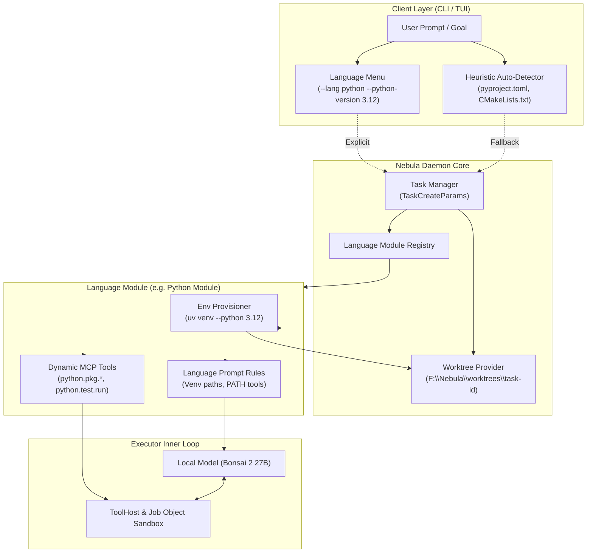
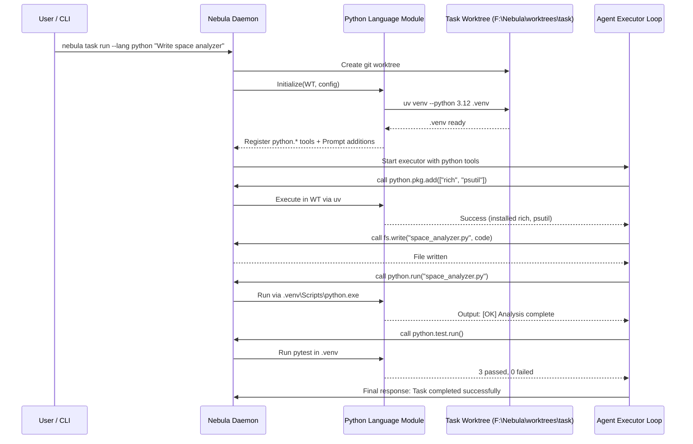

# Nebula Dedicated Language Modules (Language Packs) — System Design

| Field | Value |
| --- | --- |
| Status | Proposed (Design Specification) |
| Date | October 2026 |
| Target | Nebula Phase 1 / Phase 2 |
| Scope | Architecture, language module lifecycle, environment isolation, tool surfaces, and language expansion |

---

## 1. Executive Summary & Vision

### 1.1 The "Jack of All Trades" Problem
In local-first autonomous software engineering, 27B-class models operate under tight context windows and bounded reasoning stamina. When tasked with writing code in an unconstrained environment, the model is forced to act as a **"jack of all trades"**:
- It must recall the disparate environment activation semantics across operating systems (e.g., PowerShell `.venv\Scripts\Activate.ps1` vs. bash `source .venv/bin/activate`).
- It must hunt for runtime binaries (`python.exe`, `pytest`, `cl.exe`, `cmake`, `cargo`), often falling victim to Windows execution alias shims (0-byte `WindowsApps` shims) or hallucinating non-existent paths on retired drives (e.g., `C:` vs. `F:`).
- It must remember CLI flag idiosyncrasies across test runners, package managers, and linters.
- It frequently pollutes the global host environment or global Python site-packages because creating and managing an isolated virtual environment across unstructured shell commands is error-prone.
- When builds or tests fail, raw terminal outputs laden with ANSI escape codes, terminal noise, or multi-megabyte traces overwhelm the model's context window.

### 1.2 The Solution: Dedicated Language Modules
Nebula adheres to the foundational tenet **"Structure Over Stamina"** (Section 5.1 of [NEBULA_DESIGN.md](NEBULA_DESIGN.md)). Rather than forcing the local model to remember the operational mechanics of every programming language, Nebula offloads language mechanics to **Dedicated Language Modules (Language Packs)**:

1. **Virtual Environments & Toolchains by Default**: Every language module guarantees a hermetic, reproducible, task-isolated environment (such as an automated `uv`-managed `.venv` for Python, or a hermetic CMake build tree for C++) inside the task's worktree.
2. **Specialized Tool Menu**: The daemon dynamically provisions language-specific tools (e.g., `python.env.*`, `python.pkg.*`, `python.test.run`, `cpp.build.*`, `sql.query.*`) scoped exclusively to the active language, eliminating global prompt clutter.
3. **Curated Context & Rule Injection**: The system prompt is automatically injected with authoritative, concise language instructions, preventing hallucinated paths or commands.
4. **Structured Diagnostic Feedback**: Compilers, test frameworks, and linters run through structured adapters that parse raw logs into standardized JSON diagnostics (`file:line:col`, error category, remediation hints) before returning results to the LLM.
5. **Interactive Menu & Auto-Detection**: Users and the agent can explicitly select target languages and versions via CLI/TUI menus, or have Nebula auto-detect the language from repository signatures.

Python serves as the **flagship pilot module**, demonstrating the full lifecycle, which subsequently serves as the standardized blueprint for C++, SQL, Rust, and future languages.

---

## 2. Core Architectural Principles



### 2.1 Hermetic Isolation by Default
No language task may modify the global system state. 
- For **Python**: The module automatically provisions and enforces a virtual environment (`.venv`) inside the task worktree (`F:\Nebula\worktrees\<task-id>\.venv`). Tools execute directly through the virtual environment's binaries without relying on shell script activation.
- For **C++**: The module maintains dedicated build trees (e.g., `build/`) and isolated toolchain environments via Job Objects, preventing lingering compiler processes or polluted include directories.
- For **SQL**: The module establishes isolated sandbox schemas or local SQLite databases for query and migration validation before touching any production database.

### 2.2 Task-Scoped Dynamic Tool Activation
Rather than advertising hundreds of tools across all conceivable languages to the LLM at all times (which wastes context and increases tool-calling hallucinations), the daemon dynamically scopes tools per task:
- When running a **Python** task, tools like `python.pkg.add`, `python.test.run`, `python.lint.run`, and `python.run` are mounted.
- When running a **C++** task, tools like `cpp.build.configure`, `cpp.build.compile`, and `cpp.test.run` are mounted.
- Common filesystem (`fs.*`) and git (`git.*`) built-ins remain available across all modules.

### 2.3 Structured Output vs. Raw Stream Spilling
In alignment with ADR-002 and issue #33, language module tools never pass raw multikilobyte compiler or test outputs directly into the reasoning context. Tools output two blocks:
1. **Block 1 (Inline JSON)**: Concise structured summary (status: pass/fail, total tests, failed test count, array of structured errors with `file`, `line`, `col`, and `message`).
2. **Block 2 (Raw Log Blob)**: The full raw output, saved into the local blob store (`F:\Nebula\logs\blobs\`) with only a short preview rendered if it exceeds the output cap.

---

## 3. Language Module Lifecycle & Architecture

Every dedicated language module implements a standard lifecycle across six distinct stages:

| Stage | Name | Description | Python Implementation | C++ Implementation |
|---|---|---|---|---|
| 1 | **Detect / Select** | Resolve target language and runtime version from flags or repository inspection. | Checks `--lang python`, `pyproject.toml`, `.python-version`, or `*.py`. | Checks `--lang cpp`, `CMakeLists.txt`, `Makefile`, `*.cpp`. |
| 2 | **Provision Env** | Create and verify hermetic local environment inside the task worktree. | Executes `uv venv` with specified Python version; generates `.gitignore`. | Initializes `build/` directory; detects MSVC / Clang compiler toolchain. |
| 3 | **Mount Tools** | Register task-specific MCP tools with daemon `ToolHost`. | Registers `python.env.*`, `python.pkg.*`, `python.test.run`, `python.run`. | Registers `cpp.build.configure`, `cpp.build.compile`, `cpp.test.run`. |
| 4 | **Specialize Prompt**| Inject language-specific tenets and tool instructions into system prompt. | Informs LLM of virtualenv paths, package management rules, test command. | Informs LLM of CMake flags, compiler targets, build error formatting. |
| 5 | **Execute & Iterate** | Run language actions inside Job Object confinement with timeout and output caps. | Runs Python scripts and test commands via venv binaries (`.venv\Scripts\python.exe`). | Invokes CMake / Ninja / `cl.exe` through Job Object boundaries. |
| 6 | **Finalize** | Run final verification, clean transient caches, record dependencies. | Runs `ruff` lint and `pytest`; commits `pyproject.toml` / lockfile. | Runs final test suite via CTest; verifies clean build without warnings. |

---

## 4. Flagship Implementation: The Python Language Module

### 4.1 Underlying Engine: `uv`
The Python module leverages `uv` as its core automation engine:
- **Zero Global Contamination**: `uv` can install and manage multiple Python versions (3.9 through 3.13) purely in user space without requiring system administrative privileges or touching the Windows registry.
- **Extreme Speed**: Virtual environment creation, resolution, and dependency installation complete in milliseconds (10–100x faster than traditional `pip` + `virtualenv`).
- **Single Static Binary**: `uv.exe` is already installed on the host and skips all `WindowsApps` execution alias pitfalls.

### 4.2 Python Module Tool Suite

| Tool Name | Tier | Arguments | Description |
|---|---|---|---|
| `python.env.ensure` | Tier 1 (Sandbox) | `{ python_version?: string }` | Ensures a `.venv` exists in the task worktree. Installs/pins the requested Python version if missing. Returns environment details. |
| `python.pkg.add` | Tier 1 (Sandbox) | `{ packages: string[], dev?: boolean }` | Installs dependencies into the virtual environment using `uv add` or `uv pip install` and updates project configuration (`pyproject.toml` or `requirements.txt`). |
| `python.pkg.list` | Tier 0 (Read) | `{}` | Lists all packages and exact versions installed in the worktree's virtual environment. |
| `python.run` | Tier 1 (Sandbox) | `{ script: string, args?: string[] }` | Executes a Python script directly using `.venv\Scripts\python.exe`. Captures combined stdout/stderr under output caps. |
| `python.test.run` | Tier 1 (Sandbox) | `{ test_path?: string, args?: string[] }` | Executes `pytest` inside the virtual environment. Returns structured test passes/failures with `file:line` citations. |
| `python.lint.run` | Tier 0 (Read) | `{ path?: string, fix?: boolean }` | Runs `ruff check` and formatting checks inside the worktree, returning structured lint errors or applying automated fixes. |

### 4.3 Virtual Environment Enforced Workflow


---

## 5. Extensibility Blueprint: Expanding to Other Languages

The modular design enables straightforward addition of new language modules by conforming to the standard `LanguageModule` interface.

### 5.1 C++ Language Module (`nebula-lang-cpp`)
- **Toolchain Resolution**: Auto-detects Visual Studio MSVC (`cl.exe`, `link.exe`, `vswhere.exe`) or Clang (`clang-cl.exe`) and CMake/Ninja.
- **Hermetic Build Directory**: Configures CMake builds within `build/` in the task worktree.
- **Dedicated Tools**:
  - `cpp.build.configure`: Runs `cmake -B build -G "Ninja" ...` with appropriate compiler toolchain flags.
  - `cpp.build.compile`: Runs `cmake --build build --target <target>`. Parses compiler diagnostics (MSVC `file(line,col): error Cxxxx:` or Clang `file:line:col: error:`) into structured JSON errors.
  - `cpp.test.run`: Invokes `ctest --test-dir build --output-on-failure` or Catch2/GoogleTest test runners.
  - `cpp.run`: Executes compiled binaries within Job Object bounds.

### 5.2 SQL & Database Language Module (`nebula-lang-sql`)
- **Dialect Management**: Supports SQLite, PostgreSQL, and MySQL dialect definitions.
- **Sandbox Environment**:
  - For SQLite: Provisions a temporary database file in the task worktree.
  - For PostgreSQL/MySQL: Connects to a dedicated, ephemeral test database/schema.
- **Dedicated Tools**:
  - `sql.schema.inspect`: Returns existing tables, columns, indexes, and foreign keys as JSON.
  - `sql.query.execute`: Runs read-only queries with row limits and timeout controls.
  - `sql.migrate.run`: Applies DDL migration files within a test transaction.
  - `sql.lint.run`: Invokes `sqlfluff` to validate query formatting and dialect-specific syntax.

### 5.3 Rust Language Module (`nebula-lang-rust`)
- **Toolchain**: Directly leverages `cargo`, `cargo-nextest`, and `cargo-clippy`.
- **Target Caching**: Maps `CARGO_TARGET_DIR` to a shared target cache (`F:\Nebula\build\target\`) to avoid full recompilations of standard crates across task worktrees.
- **Dedicated Tools**:
  - `rust.build.run`: Runs `cargo build` and parses compiler error codes.
  - `rust.test.run`: Runs `cargo nextest run` with structured pass/fail output.
  - `rust.lint.run`: Runs `cargo clippy -- -D warnings`.

---

## 6. User Experience & Interfaces

### 6.1 CLI Interface
Users can explicitly select or configure language modules through the `nebula` CLI:

```powershell
# Run a task with explicit Python module and version
nebula task run --lang python --python-version 3.12 "Create a smart storage manager script"

# Auto-detect language from repository files
nebula task run "Add unit tests for the invoice calculation module"

# Inspect available language modules and installed toolchains
nebula lang list
nebula lang info python
nebula lang info cpp
```

### 6.2 Interactive TUI Menu
When creating a task inside the Nebula Terminal UI (`nebula tui`):
1. The user inputs their prompt/goal.
2. An interactive language selection modal displays:
   ```text
   ┌ Select Language Module ──────────────────────────────┐
   │ > [Auto-detect from repository]                     │
   │   Python (uv, venv, pytest, ruff)                   │
   │   C++ (MSVC/Clang, CMake, CTest)                    │
   │   SQL (Schema introspection, Query sandbox, Linters)│
   │   Rust (Cargo, nextest, clippy)                     │
   │   Generic Polyglot (Raw shell tools only)           │
   └──────────────────────────────────────────────────────┘
   ```
3. If Python is chosen, a sub-prompt allows selecting or confirming the Python runtime version (e.g., `3.12 (Default)`, `3.11`, `3.13`).

---

## 7. Security, Sandboxing, and System Invariants

1. **Rule 5 Compliance (Never Touch C:)**: Language module environments and virtual environment paths must reside strictly on drive `F:` (or cold storage `D:` for archives). The path validator rejects any configuration attempting to resolve toolchains or virtual environments on `C:`.
2. **Job Object Containment**: Every process spawned by a language module (Python interpreter, `uv`, `cmake`, compiler processes) is enrolled in the task's Windows Job Object with `KILL_ON_JOB_CLOSE`. Process termination kills all child processes immediately.
3. **Permission Tiers**:
   - Environment reading and linting: **Tier 0 (Read)**.
   - Virtualenv script execution, test runs, and local build compilation: **Tier 1 (Sandbox)**.
   - Global package installations outside the worktree: **Denied / Strictly Forbidden**.

---

## 8. Rollout Plan & Implementation Milestones

- **Phase 1A: Core Architecture & Python Flagship Module**:
  - Implement `LanguageModule` trait and registry in daemon.
  - Implement Python module using `uv` with `.venv` creation and `python.*` tools.
  - Update `nebula task run` CLI with `--lang` and `--python-version` options.
- **Phase 1B: TUI Language Menu & Heuristic Auto-Detection**:
  - Integrate interactive language selector into the Ratatui TUI.
  - Implement repository file signature auto-detection.
- **Phase 1C: C++ and SQL Modules**:
  - Implement C++ module with CMake and MSVC diagnostic parsing.
  - Implement SQL module with SQLite schema inspection and test query runner.
