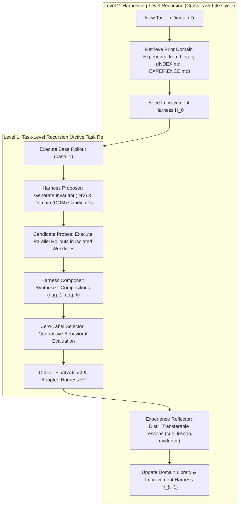

# Recursive Agent Harnessing: Post-Phase 1 Capabilities & Self-Improvement Architecture

## 1. Executive Summary & Foundational Research

This document specifies the architectural blueprint for Nebula's post-Phase 1 recursive self-improvement subsystem. It translates the theoretical principles, mathematical formulations, and systems mechanics introduced by Google Research in **Harness²: Recursive Agent Harnessing for an Open World** ([arXiv:2610.14224](https://arxiv.org/abs/2610.14224), Oct 2026, Xu et al.) into a concrete systems design optimized for Nebula's local-first, single-GPU Windows workstation environment (RTX 4070 12 GB, 32 GB RAM, MSVC Rust runtime).

### The Core Thesis: Fixed-Weight Recursive Self-Improvement
Conventional self-improvement literature often assumes model weight updates via reinforcement learning (RL) or continual fine-tuning. On a local development machine with tight VRAM and compute constraints, weight fine-tuning is computationally prohibitive and risks catastrophic forgetting. 

Harness² establishes an alternative paradigm: **Recursive Agent Harnessing**. A *harness* is defined as the complete operational software envelope surrounding a frozen foundation model: prompts, schemas, tool interfaces, deterministic scripts, on-demand skills, memory, and orchestration middleware. *Harnessing* is the algorithmic optimization of this envelope.

```
+-------------------------------------------------------------------------------+
|                                HARNESS ENVELOPE                               |
|                                                                               |
|  +--------------------+   +-----------------------+   +--------------------+  |
|  | Context & Prompts  |   | Tool Interfaces & MCP |   | Middleware & Hooks |  |
|  | (c1, c2, c3, c4)   |   | (c4, c7)              |   | (c8)               |  |
|  +--------------------+   +-----------------------+   +--------------------+  |
|                                                                               |
|                   +-------------------------------+                           |
|                   |   FROZEN FOUNDATION MODEL     |                           |
|                   |   (Bonsai 2 27B / Gemma 4)    |                           |
|                   +-------------------------------+                           |
|                                                                               |
|  +--------------------+   +-----------------------+   +--------------------+  |
|  | On-Demand Skills   |   | Delegated Subagents   |   | Worktree Sandbox   |  |
|  | (c6)               |   | (c5)                  |   | (Job Objects)      |  |
|  +--------------------+   +-----------------------+   +--------------------+  |
+-------------------------------------------------------------------------------+
```

By keeping foundation model weights strictly fixed and optimizing the modular harness components, Nebula achieves recursive capability compounding, self-correcting workflows, and cross-task domain specialization without training runs or catastrophic model drift.

---

## 2. Deconstruction of Google Harness²

Google's Harness² provides three fundamental innovations that directly resolve open problems in Nebula's long-term roadmap:

1. **The 8 Component Tree Taxonomy ($c_1 \dots c_8$)**: A comprehensive decomposition of the editable agent surface into distinct functional components with explicit runtime costs.
2. **The Two-Level Recursion Hierarchy**: Separation of task-level execution refinement from cross-task experience accumulation.
3. **Zero-Label Contrastive Evaluation**: Systematic harness optimization in open-world settings where human rubrics, test suites, and ground-truth answers do not exist.

### 2.1 The 8 Component Tree ($c_1 \dots c_8$)
Harness² categorizes every editable element of an agent's harness into an 8-component tree (`SurfaceSpec` in `harness2/core/tree.py` and `substrate/codex.py`):

| Component | Identifier | Runtime Role | Ingestion Mode | Token & Compute Cost |
| :--- | :--- | :--- | :--- | :--- |
| **System Prompt** | $c_1$ | Persona, core procedure, completion contract | **Always On** | **High**: Injected on every turn; directly competes with output token budget. |
| **Guardrails** | $c_2$ | Standing security rules, boundary limits | **Always On** | **High**: Deducts from turn context. |
| **Durable Memory** | $c_3$ | Verified workspace facts, schemas, mappings | **Always On** | **High**: Must be tightly budgeted. |
| **Tool Guidance** | $c_4$ | Tool usage prose, parameter guidelines | **Always On** | **High**: Proportional to tool catalogue size. |
| **Delegated Subagents** | $c_5$ | Isolated sub-tasks with bounded context | **On Demand** | **Zero until spawned**; operates in fresh context window. |
| **Skills** | $c_6$ | Reusable procedural workflows (`SKILL.md`) | **On Demand** | **Zero until invoked**; name/description advertised up front. |
| **Deterministic Scripts** | $c_7$ | Standalone helper scripts (`.py`, `.ps1`) | **On Demand** | **Zero LLM tokens**; executed directly via subshell/subprocess. |
| **Tool-Loop Middleware** | $c_8$ | Lifecycle hooks (`PreToolUse`, `PostToolUse`) | **Always Active** | **Zero prompt tokens**; acts inside the executor loop. |

#### The "Cost Hierarchy" Law
A primary empirical finding from the Harness² paper (`prompts.py` lines 129–147) is that **always-on prose is the most expensive and brittle intervention**. Every token added to $c_1, c_2, c_3, c_4$ permanently reduces the model's generation headroom and increases attention dissipation. Runaway reasoning loops frequently stem from bloated always-on instructions.

Consequently, Harness² enforces a strict preference order for self-improvement:
1. **Tool-Loop Hooks ($c_8$)**: The highest-leverage lever. Hooks execute deterministically inside the tool invocation loop. They cannot be skipped, forgotten, or hallucinated past by the model.
2. **Deterministic Scripts ($c_7$)**: Offload arithmetic, regex transforms, AST analysis, and data normalization to local scripts.
3. **On-Demand Skills ($c_6$)**: Package specialized domain procedures with clear trigger conditions. They cost zero context tokens until explicitly triggered.
4. **Delegated Subagents ($c_5$)**: Deploy only when input volume is large but required output summary is small.
5. **Always-On Text ($c_1 \dots c_4$)**: Used strictly as the last resort for short, universal invariants. When text is added, existing text must be excised to preserve token budgets.

### 2.2 Two-Level Recursion Hierarchy
Harness² structures recursion across two distinct temporal horizons:



#### Level 1: Task-Level Recursion (Active Task Refinement)
For an individual incoming task, the agent does not merely execute a single prompt-response loop. Instead, it enters a contrastive **Propose–Probe–Compose** cycle:
- **Propose**: The harness proposer generates candidate modifications split across two orthogonal dimensions:
  - **Invariant Levers (`INV`)**: Procedural discipline, error recovery, verification loops, formatting constraints.
  - **Domain Levers (`DOM`)**: Domain-specific heuristics, terminology mapping, structural validation rules.
- **Probe**: Candidate harnesses are rolled out against the active task in isolated environments.
- **Compose**: A composer analyzes behavioral contrasts between rollouts (errors encountered, tool trajectories, output schemas) and synthesizes composed harnesses combining compatible improvements.
- **Select**: A selector model evaluates the anonymized outputs without ground-truth labels and commits the winning output.

#### Level 2: Harnessing-Level Recursion (Cross-Task Knowledge Flywheel)
After task completion, an **Experience Reflector** reviews the adopted harness, candidate trajectories, and selection rationale. It distills a structured experience record (`EXPERIENCE.md`) containing:
- `cue`: The operational pattern or problem signature that triggers this adaptation.
- `lesson`: Concise, actionable rule for future tasks.
- `evidence`: Concrete trajectory diff demonstrating the improvement.
- `confidence`: Calibrated rating based on execution contrast.

These lessons are committed to the persistent **Domain Experience Library** (`<domain>/harnesses/<task_id>/`), providing a cumulative knowledge flywheel that bootstraps subsequent tasks in the same domain.

### 2.3 Mathematical Resource Formulations
Harness² defines precise resource invariants for task-level recursion parameterized by recursion budget $k$:

- **Parallel Mode (Width Exploration)**:
  - Proposes $2k$ candidate harnesses: $k$ invariant (`INV`) and $k$ domain (`DOM`) variants.
  - Executes $2k$ parallel probes.
  - Generates $k$ independent compositions (`agg1..aggk`).
  - Total improvement stages: $P = 3k$.
  - Total rollouts (including shared base): $R = 4k$.
- **Sequential Mode (Depth Refinement)**:
  - Iteratively executes $k$ successive Propose-Probe-Compose rounds ($c_1 \to c_2 \to \dots \to c_k$), accumulating evidence across rounds.
  - Total improvement stages: $P = 3k$.
  - Total rollouts: $R = 4k$.

---

## 3. Hardware Adaptation: Porting Harness² to Local Workstation Constraints

Google Harness² was designed for cloud deployments, spinning up concurrent API calls across Vertex AI (Gemini 1.5/2.0 Pro) or Anthropic Claude 3.5 Sonnet. Porting this framework to Nebula's dedicated local hardware (RTX 4070 12 GB, 32 GB RAM, MSVC Windows toolchain) requires resolving three critical hardware constraints:

### 3.1 Constraint 1: VRAM & Context Space Limits
A single chat profile on Nebula (e.g., Bonsai 2 27B at 32K context with speculative decoding) consumes ~9.5 GB of VRAM. Attempting to run $4k$ concurrent rollouts in parallel would cause immediate CUDA out-of-memory crashes or force models into slow CPU offload.

#### Architectural Mitigation: Pipelined Batched Probing with KV-Cache Re-use
Nebula replaces wide cloud concurrency with **pipelined serial-batch execution**:
1. **Shared Base KV-Cache**: The initial system prompt and workspace source materials are loaded into `llama-server`. The prompt context prefix is cached in VRAM using `llama.cpp` slot memory.
2. **Sequential Probe Execution**: Probes are scheduled sequentially across sibling git worktrees. Because the large context prefix is shared, prompt evaluation time ($T_{eval}$) for subsequent probes drops by up to 80%.
3. **Adaptive Budgeting ($k=1$ default)**:
   - For interactive developer tasks: $k=1$ ($P=3, R=4$), running 1 `INV`, 1 `DOM`, and 1 `AGG` pass. Total execution time: ~90–120 seconds.
   - For unattended/overnight tasks: $k=2$ or $k=3$ running in background idle periods.

### 3.2 Constraint 2: Windows NTFS Filesystem & Job Object Isolation
Unlike Linux containers where directories can be cloned instantaneously with `btrfs` or overlayfs, Windows file locking and NTFS metadata overhead can bottleneck rapid worktree creation.

#### Architectural Mitigation: Worktree Pool & Sibling Worktree Allocator
Nebula leverages Git worktrees anchored to `F:\Nebula\worktrees\`:
- A base task worktree is created at `F:\Nebula\worktrees\task-<id>`.
- Probe branches are created as sibling worktrees: `task-<id>-inv1`, `task-<id>-dom1`, `task-<id>-agg1`.
- Every process spawned within a probe worktree is assigned to a dedicated Windows Job Object (`CURRENT_TASK_JOB` via `JobChild` in `crates/nebula-tools/src/builtins/task_job_seam.rs`). When a probe terminates, the Job Object terminates all child processes instantly, preventing `.git/index.lock` collisions.

---

## 4. Systems Architecture: Mapping Harness² to Nebula Primitives

The following matrix formally maps Harness² concepts to Nebula's Phase 0 foundations and Phase 1/Phase 2 implementation targets:

| Harness² Concept | Harness² Implementation (`scratch/harness2`) | Nebula Primitive / Target Component | Status / Milestone |
| :--- | :--- | :--- | :--- |
| **Harness Surface** | `SurfaceSpec` (`core/tree.py`, `substrate/codex.py`) | `crates/nebula-config/src/harness.rs`, `.agents/` | **Phase 2 Specification** |
| **System Prompt ($c_1$)** | `AGENTS.md` / `systemprompt.md` | `crates/nebula-daemon/src/executor/prompt.rs` | **Phase 1 Active** |
| **Guardrails ($c_2$)** | `guardrails.md` / `.codex/rules.json` | `config/rules.toml`, `crates/nebula-sandbox` | **Phase 1 Active** |
| **Durable Memory ($c_3$)** | `LongTermMEMORY.md` | SQLite episodic store `F:\Nebula\state\memory.db` | **Phase 2 Planned** |
| **Tool Interface ($c_4$)** | `tool_guidance.md` | MCP Server schema reflection (`tools/nebula-devtools`) | **Phase 1 Active** |
| **Subagents ($c_5$)** | `sub_agents/<name>/AGENT.md` | Multi-agent executor in `crates/nebula-daemon` | **Phase 2 Planned** |
| **Skills ($c_6$)** | `.agents/skills/<name>/SKILL.md` | `.agents/skills/` directory on workspace root | **Phase 1 Active** |
| **Helper Scripts ($c_7$)** | `scripts/<name>.py` | Sandboxed Python scripts via `tools/nebula-devtools` | **Phase 1 Active** |
| **Tool Hooks ($c_8$)** | `.codex/hooks.json` / plugin TS | MCP filter pipeline / `crates/nebula-daemon/src/hooks.rs` | **Phase 2 Planned** |
| **Worktree Isolation** | Temp workspace directories | `F:\Nebula\worktrees\task-<id>` (Issue #29, #72) | **Phase 1 Active** |
| **Process Concurrency** | Python `subprocess` | Windows Job Objects (`task_job_seam.rs`, Issue #79) | **Phase 1 Active** |
| **Domain Library** | `core/library.py` | `F:\Nebula\state\library\<domain>/` | **Phase 3 Planned** |
| **Experience Ledger** | `core/ledger.py` | `crates/nebula-daemon/src/telemetry/ledger.rs` | **Phase 2 Planned** |

---

## 5. Algorithmic Mechanics: Propose–Probe–Compose in Nebula

```mermaid
sequenceDiagram
    autonumber
    participant D as Daemon Executor
    participant P as Proposer Engine
    participant W as Worktree Manager
    participant J as Windows Job Object
    participant S as Zero-Label Selector
    participant L as Domain Library

    D->>L: Query domain experience for task
    L-->>D: Return INDEX.md + relevant EXPERIENCE.md
    D->>W: Allocate primary worktree task-01
    D->>D: Execute Base Rollout (base_1)
    
    rect rgb(240, 248, 255)
        Note over D,P: Task-Level Recursion (k=1)
        D->>P: Propose INV candidate (procedural invariants)
        D->>P: Propose DOM candidate (practitioner knowledge)
        P-->>D: Return harness_inv1 and harness_dom1
        
        D->>W: Create sibling worktree task-01-inv1
        D->>J: Spawn probe runner in Job Object
        J-->>D: Rollout inv1 complete (diagnostics, artifacts)
        
        D->>W: Create sibling worktree task-01-dom1
        D->>J: Spawn probe runner in Job Object
        J-->>D: Rollout dom1 complete (diagnostics, artifacts)
        
        D->>P: Compose harness from execution contrasts
        P-->>D: Return composed harness_agg1
        D->>W: Create sibling worktree task-01-agg1
        D->>J: Execute rollout agg1 in Job Object
        J-->>D: Rollout agg1 complete
    end
    
    D->>S: Submit anonymized candidates {base, inv1, dom1, agg1}
    S-->>D: Select winning candidate H* (zero-label contrast)
    D->>W: Commit winning changes to task-01; prune sibling worktrees
    D->>L: Distill EXPERIENCE.md and update Domain Library
```

### 5.1 The Proposer Contract
The Proposer operates on an isolated context directory containing:
- `context/task.md`: The stripped user prompt without answer keys or rubrics.
- `context/harness/`: The active editable harness tree ($c_1 \dots c_8$).
- `context/rollouts/`: Transcripts of prior rollouts on this task, formatted with `[ACTION]`, `[OBSERVATION]`, and `[ERROR]` delimiters.
- `context/library/`: Prior domain experience.

#### Invariant Proposal (`INV`)
The invariant proposer focuses strictly on execution mechanics:
- Distinguishes fatal tool crashes from benign non-zero exits.
- Detects mechanical repetition (e.g., model repeatedly trying regex edits on large files) and emits a deterministic script ($c_7$).
- Identifies missing procedural workflows and generates a skill ($c_6$) with mandatory trigger line injection into $c_1$.
- Adds tool-loop interceptors ($c_8$) to block repeated failure patterns.

#### Domain Proposal (`DOM`)
The domain proposer focuses strictly on subject-matter correctness:
- Enforces artifact schemas (e.g., requiring specific header layouts, error handling patterns, or test coverage).
- Adds domain decision rules to $c_3$ (Durable Memory) or $c_6$ (Skills).
- Strictly forbids inventing unverified facts or library paths.

### 5.2 Zero-Label Contrastive Selection
A major vulnerability in automated self-improvement is the assumption that an oracle or unit-test suite is always present. In real developer tasks, tests may be incomplete, broken, or non-existent.

Nebula adapts Harness²'s **Zero-Label Selection Protocol** (`harness2/core/selection.py`):
1. **Sanitization & Anonymization**: Candidate artifacts are collected and assigned randomized identifiers ($A, B, C, \dots$) via seeded SHA-1 hashes of `(task_id, k, mode)`.
2. **Behavioral Filter**: Rollouts that failed to build, threw unhandled panics, or produced empty files are dropped before selection.
3. **Comparative Analysis**: The selector model is prompted to contrast deliverables based on:
   - Did the candidate satisfy all explicit constraints in `task.md`?
   - Did the candidate introduce compilation or syntax regressions?
   - Is the deliverable complete and verifiable, or does it leave unfinished placeholders?
4. **Fallback Safety**: If the selector fails or LLM outputs malformed selection blocks, the system safely falls back to the baseline rollout (`base_1`).

---

## 6. Implementation Roadmap: Post-Phase 1 Phases

```
+-----------------------------------------------------------------------------------+
| PHASE 1: Execution Foundations & Tool Sandboxing (ACTIVE MILESTONE)               |
| - Rust daemon + Win32 named pipes                                                 |
| - Git worktree manager & Windows Job Object boundary (Issue #29, #72, #79)        |
| - Devtools MCP server (tools/nebula-devtools)                                     |
| - Permission tiers (Tier 0 to Tier 3) & Protected Set gate (Issue #75, #80)       |
+-----------------------------------------------------------------------------------+
                                          |
                                          v
+-----------------------------------------------------------------------------------+
| PHASE 2: Task-Level Recursive Harnessing (LEVEL 1 RECURSION)                      |
| - Sibling worktree allocator (task-<id>-inv, task-<id>-dom, task-<id>-agg)        |
| - Propose-Probe-Compose engine integrated into nebula-daemon                      |
| - Local KV-cache prefix re-use on llama-server slots                              |
| - Zero-label selection parser & behavioral contrast grader                        |
| - On-demand skill (c6) & script (c7) generation engine                            |
+-----------------------------------------------------------------------------------+
                                          |
                                          v
+-----------------------------------------------------------------------------------+
| PHASE 3: Metacognition & Continuous Domain Library (LEVEL 2 RECURSION)            |
| - Persistent Domain Experience Library in F:\Nebula\state\library\<domain>/       |
| - Post-task Experience Reflector (distilling cue, lesson, evidence)               |
| - Automated canary evaluation harness (running evals/ regression suite)           |
| - Protected Set promotion gate: Elevating proven task skills to workspace defaults|
+-----------------------------------------------------------------------------------+
```

### Phase 2: Task-Level Recursive Harnessing (Target: v0.2.0)
1. **Worktree Forking Engine**: Extend `crates/nebula-sandbox` to support transient sibling worktrees branched off the active task branch.
2. **Proposer & Composer Seams**: Implement structured prompt interpolation for `INV`, `DOM`, and `AGG` stages in `crates/nebula-daemon`.
3. **Deterministic Verification Adapter**: Connect `tools/nebula-devtools` (`test.run`, `build.run`, `lint.run`) to provide structured diagnostic signals into rollout transcripts.

### Phase 3: Metacognitive Experience Library (Target: v0.3.0)
1. **Domain Library Subsystem**: Implement `F:\Nebula\state\library\<domain>/` with automatic indexing, versioning, and retrieval by task signature.
2. **Experience Reflector**: Deploy post-task reflection sessions to distill reusable engineering patterns.
3. **Canary & Regression Gating**: Implement the canary test harness (`NEBULA_DESIGN.md` Section 11.4) to benchmark proposed global harness updates against held-out regression suites before promotion.

---

## 7. Security Perimeter, Sandboxing, & Invariant Preservation

Autonomous self-modification introduces severe security risks: prompt injections can compromise guardrails, self-generated scripts can trigger host command escapes, and recursive loops can fork bomb system resources. Nebula enforces strict security invariants rooted in Phase 0 and Phase 1 foundations:

### Invariant 1: The L4 Protected Set Boundary
As mandated by `NEBULA_DESIGN.md` Section 11.5, certain critical components remain **strictly immutable** to autonomous modification:
- `config/policy.toml` and permission tier definitions.
- `crates/nebula-sandbox/src/redteam.rs` and security invariants.
- `.github/workflows/` CI definitions and git hook configurations.
- The evaluation benchmark suites (`evals/`).

Autonomous self-improvement may propose modifications to L4 files only as advisory markdown artifacts; human review and manual application are mandatory.

### Invariant 2: Script Execution Quarantining ($c_7$)
Any deterministic script generated by the harness proposer (e.g., `scripts/reconcile.py`) is strictly quarantined:
- Scripts are written exclusively inside the task's worktree (`F:\Nebula\worktrees\task-<id>\scripts\`).
- Scripts execute under Windows Job Objects with strict execution time limits (default: 30s) and memory caps (default: 2 GB).
- Sandboxed scripts inherit only Tier 0/Tier 1 environment access; raw drive access outside the worktree is rejected by path validation.

### Invariant 3: Invariant vs Domain Separation
Following the Harness² prompt contracts (`prompts.py` lines 347–408), invariant proposals (`INV`) and domain proposals (`DOM`) are strictly partitioned:
- An `INV` proposal cannot alter domain rules, acceptance criteria, or business logic.
- A `DOM` proposal cannot alter execution timeouts, retry loops, permission tiers, or shell policies.
This orthogonality guarantees that domain adaptations cannot weaken core execution safeguards.

---

## 8. Primary Source Citation & Audit Matrix

To ensure absolute traceability and verifiable provenance, every architectural concept in this specification is mapped directly to source files and line ranges in Google Research's Harness² repository (`scratch/harness2`):

| Architectural Concept | Primary Source File (`harness2/`) | Line Range | Verifiable Artifact / Class |
| :--- | :--- | :--- | :--- |
| **8-Component Surface** | `harness2/core/tree.py` | L40–L150 | `SurfaceSpec`, `is_allowed`, `read_tree` |
| **Codex Surface Contract** | `harness2/substrate/codex.py` | L39–L105 | `CODEX_SURFACE` (AGENTS.md, .agents/skills, hooks) |
| **Two Recursion Modes** | `harness2/core/recursion.py` | L343–L510 | `run_parallel`, `run_sequential`, `Stage`, `ModeResult` |
| **INV / DOM Templates** | `harness2/core/prompts.py` | L347–L408 | `_INV_TEMPLATE`, `_DOM_TEMPLATE`, `_SURFACE_CODEX` |
| **Cost Hierarchy Law** | `harness2/core/prompts.py` | L129–L147 | Always-on prose vs on-demand skills / scripts / hooks |
| **Zero-Label Selection** | `harness2/core/selection.py` | L268–L358 | `run_selection`, `assign_ids`, `_render_pool` |
| **Experience Distillation** | `harness2/core/selection.py` | L454–L506 | `_distil`, `<experience>`, `<edits>`, `cue/lesson/evidence` |
| **Domain Library & Index** | `harness2/core/library.py` | L57–L182 | `Library`, `add`, `rebuild_index`, `INDEX.md` |
| **Execution Budgets** | `harness2/core/ledger.py` | L24–L65 | `Ledger`, budget identity $P=3k, R=4k$ |
| **Research Paper Citation** | `README.md` | L186–L193 | arXiv:2610.14224 (Oct 2026, Xu et al.) |
